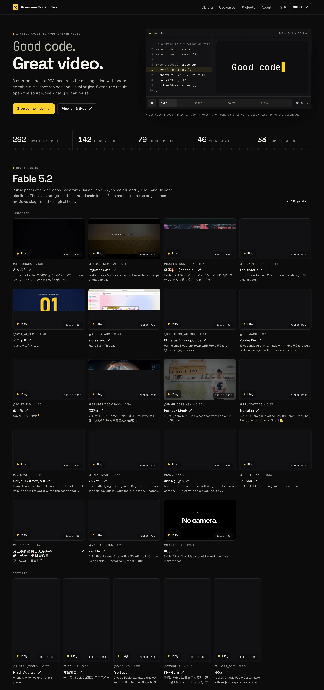
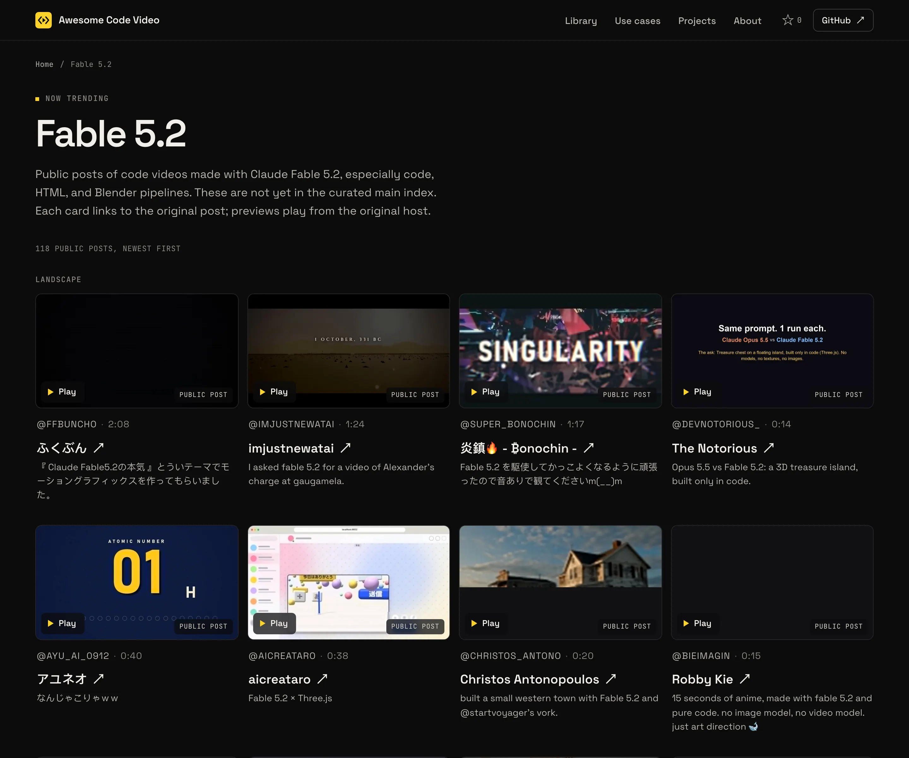

# Awesome Code Video 

> Reusable visual styles, shot recipes, and editable templates for making videos with code.

**English** · [简体中文](README.zh-CN.md)

**Website:** [https://awesomecodevideo.com/](https://awesomecodevideo.com/) · [Search the resource library](https://awesomecodevideo.com/library/) · [Browse by use case](https://awesomecodevideo.com/collections/)

Browse visual previews, filter resources by framework and type, and open source links with practical reuse notes on the website.

Code video, also called **programmatic video** or **video as code**, uses HTML, Canvas, SVG, React, TypeScript, or Python to compose and render moving images. This list focuses on reusable parts: a product-launch film you can adapt, a camera move you can integrate, or a visual style you can use to direct a new film.

Find **video templates, motion graphics, product demos, explainers, data stories, and map animations**, with specific source links and practical reuse notes. The list contains 267 reusable examples, recipes, and styles, plus a small set of supporting frameworks and workflows. Resources were reviewed through their source files and documentation; inclusion does not mean each project has been installed or render-tested.

Only public, inspectable resources with clear reuse permissions are included. Encrypted or account-bound template source, noncommercial-only restrictions, and unresolved licenses are excluded. Open-source copyright notices do not disqualify a project.

[][homepage-hero]

[][fable-spotlight]

[homepage-hero]: https://awesomecodevideo.com/
[fable-spotlight]: https://awesomecodevideo.com/spotlight/fable-5-2/

## Contents

- [Claude Fable 5.2](#claude-fable-52)
- [Start Here](#start-here)
- [Film and Scene Templates](#film-and-scene-templates)
- [Map Animation Presets](#map-animation-presets)
- [Shot Recipes](#shot-recipes)
- [Visual Style Templates](#visual-style-templates)
- [Frameworks and Renderers](#frameworks-and-renderers)
- [Motion Design Tools](#motion-design-tools)
- [Production Workflows](#production-workflows)
- [Generative Video Prompts](#generative-video-prompts)

## Claude Fable 5.2

A public gallery of code videos made with Claude Fable 5.2 is on the website at [https://awesomecodevideo.com/spotlight/fable-5-2/](https://awesomecodevideo.com/spotlight/fable-5-2/). These are original public posts, played from their original host. They are not yet in the curated index below, and they are not part of the 267 reusable examples, recipes, and styles.

## Start Here

| Make this                          | Start with    | What you reuse                                                   |
| ---------------------------------- | ------------- | ---------------------------------------------------------------- |
| A SaaS or knowledge-product launch | Ink Press     | A complete film project with an established sequence and timing. |
| A paper-collage explainer          | Paper-Cut     | A layered scene and its animation timeline.                      |
| A travel or location story         | Map presets   | Configurable location, route, and flight examples.               |
| A product feature demonstration    | Shot recipes  | Individual shots with implementation references.                 |
| A whiteboard or data explainer     | Visual styles | Art direction and production instructions for a new film.        |
| A pixel-art narrative              | Claude Quest  | A worked film project and a retro game engine.                   |

**Project** means editable source, often with substantial adaptation. **Preset** means a parameterized example. **Recipe** means a shot and implementation you integrate into your own timeline. **Style** means instructions for creating a new film, rather than a ready-made render project. None of these labels promises one-click output.

## Film and Scene Templates

Complete projects and self-contained scenes with editable source.

- [Ink Press](https://github.com/Vincentwei1021/video-shotcraft/tree/main/template) - Warm paper, ink typography, and amber accents for SaaS, research tools, and knowledge-product launches. A 36.2-second, ten-shot Remotion project with title cards, page-camera moves, captions, and timed sound effects. Replace screenshots, element crops, copy, branding, and page coordinates; adapt camera framing to the new interface. The documented version is 1080p at 30 fps with sound effects and no background music.
- [Paper-Cut Five-Layer Motion](https://github.com/HeiGeAi/Paper-Cut/tree/main/examples/five-layer-motion) - Editorial paper collage, torn edges, print texture, and layered parallax for history, people, and concept explainers. A 20-second silent HyperFrames / GSAP scene with assembly, separation, collision, and recomposition. Replace the artwork and derived layers; extraction masks are tied to the original image and must be adjusted for new compositions.
- [Butterfly Life](https://github.com/kuhnhomeuk-cell/procedural-film/tree/main/examples/butterfly-life) - Procedural natural-science animation for lifecycle and process explainers. A 32-second, 17-shot vertical film with source, planning documents, music, and rendering tools. Reuse the production structure; changing the subject requires adapting drawing and scene code.
- [Claude Quest](https://github.com/kuhnhomeuk-cell/procedural-film/tree/main/examples/claude-quest-v2) - NES-style pixel art, a simulated CRT, and chip music for game narratives, progress metaphors, and playful technical stories. A worked film driven by a game engine and recorded controller input. Reuse the engine and presentation; adapt characters, levels, and the input sequence for a new story.
- [Isometric Ripple Tank](https://github.com/wheresryan22/anatomy/tree/main/examples/ripple-tank) - An isometric laboratory scene combining SVG apparatus and WebGL water patterns for wave-interference explainers. Reuse the Node build script, light or dark page, and frequency/spacing controls. Adapt the model, labels, and interaction sequence; add browser recording or a controlled video timeline and audio. The example outputs HTML, not an MP4.

- [Podcast Audiogram](https://github.com/remotion-dev/remotion/tree/main/packages/template-audiogram) - Audio waveforms and synchronized captions for podcast excerpts and interview highlights. Reuse the Remotion composition and audio-driven duration; replace audio, caption data, and visualizer settings. Review the Remotion license for your organization before production.
- [Code Hike Transitions](https://github.com/remotion-dev/remotion/tree/main/packages/template-code-hike) - Animated syntax-highlighted code with token transitions and annotations for programming tutorials and refactoring walkthroughs. Reuse the frame-driven Remotion scene; replace code snippets, themes, annotations, and pacing. Review the Remotion license for your organization before production.
- [Word-Highlighted Captions](https://github.com/remotion-dev/remotion/tree/main/packages/template-tiktok) - Bold outlined captions with active-word highlighting and animated entrances for talking-head clips and social explainers. Reuse the captioned-video composition; replace footage, captions, fonts, and placement. Adapt transcription settings for your language and review the Remotion license before production.
- [Overlay Template](https://www.remotion.dev/templates/overlay) - Official Remotion template page for overlay. Preview is the official OG PNG thumbnail only (no hotlinkable MP4). Template terms 待确认; Remotion runtime license separate. Do not copy the OG image into the catalog.
- [Three.js Template](https://www.remotion.dev/templates/three) - Official Remotion template page for three. Preview is the official OG PNG thumbnail only (no hotlinkable MP4). Template terms 待确认; Remotion runtime license separate. Do not copy the OG image into the catalog.
- [Music Visualization Template](https://www.remotion.dev/templates/music-visualization) - Official Remotion template page for music-visualization. Preview is the official OG PNG thumbnail only (no hotlinkable MP4). Template terms 待确认; Remotion runtime license separate. Do not copy the OG image into the catalog.
- [Hello World Template](https://www.remotion.dev/templates/hello-world) - Official Remotion template page for hello-world. Preview is the official OG PNG thumbnail only (no hotlinkable MP4). Template terms 待确认; Remotion runtime license separate. Do not copy the OG image into the catalog.
- [Recorder Template](https://www.remotion.dev/templates/recorder) - Official Remotion template page for recorder. Preview is the official OG PNG thumbnail only (no hotlinkable MP4). Template terms 待确认; Remotion runtime license separate. Do not copy the OG image into the catalog.
- [Skia Template](https://www.remotion.dev/templates/skia) - Official Remotion template page for skia. Preview is the official OG PNG thumbnail only (no hotlinkable MP4). Template terms 待确认; Remotion runtime license separate. Do not copy the OG image into the catalog.
- [Electron Template](https://www.remotion.dev/templates/electron) - Official Remotion template page for electron. Preview is the official OG PNG thumbnail only (no hotlinkable MP4). Template terms 待确认; Remotion runtime license separate. Do not copy the OG image into the catalog.

- [KPI Counter](https://github.com/RenderComp/free-remotion-templates/blob/main/src/components/kpi-counter/KpiCounter.tsx) - A self-contained Remotion composition that counts KPI figures on staggered cards. The README documents it as 1920 by 1080 and 4 seconds, and KpiCounter.tsx sets 120 frames at 30 fps. Reuse the component and its typed props, and keep the MIT notice. The linked preview is the official Cloudflare R2 MP4, hotlinked and not copied into this repository, and Remotion's runtime license is separate.
- [Animated Bar Chart](https://github.com/RenderComp/free-remotion-templates/blob/main/src/components/bar-chart-anim/BarChartAnim.tsx) - A self-contained Remotion composition that grows bars to a data series. The README documents it as 1920 by 1080 and 5 seconds. Reuse BarChartAnim.tsx and its props, and keep the MIT notice. The linked preview is the official Cloudflare R2 MP4, hotlinked and not copied into this repository, and Remotion's runtime license is separate.
- [Glitch Text](https://github.com/RenderComp/free-remotion-templates/blob/main/src/components/glitch-text/GlitchText.tsx) - A self-contained Remotion title composition that splits and then settles glitch text. The README documents it as 1920 by 1080 and 4 seconds. Reuse GlitchText.tsx and its props, and keep the MIT notice. The linked preview is the official Cloudflare R2 MP4, hotlinked and not copied into this repository, and Remotion's runtime license is separate.
- [Logo Blur Reveal](https://github.com/RenderComp/free-remotion-templates/blob/main/src/components/logo-blur-reveal/LogoBlurReveal.tsx) - A self-contained Remotion composition that sharpens a logo out of blur. The README documents it as 1920 by 1080 and 4 seconds. Reuse LogoBlurReveal.tsx and its props, and keep the MIT notice. The linked preview is the official Cloudflare R2 MP4, hotlinked and not copied into this repository, and Remotion's runtime license is separate.
- [Typewriter](https://github.com/RenderComp/free-remotion-templates/blob/main/src/components/typewriter/Typewriter.tsx) - A self-contained square Remotion composition that types copy with a cursor. The README documents it as 1080 by 1080 and about 3.3 seconds. Reuse Typewriter.tsx and its props, and keep the MIT notice. The linked preview is the official Cloudflare R2 MP4, hotlinked and not copied into this repository, and Remotion's runtime license is separate.
- [Racing Bar Chart](https://github.com/RenderComp/free-remotion-templates/blob/main/src/components/racing-chart/RacingChart.tsx) - A self-contained Remotion composition that reranks bars as values change. The README documents it as 1920 by 1080 and 7 seconds. Reuse RacingChart.tsx and its props, and keep the MIT notice. The linked preview is the official Cloudflare R2 MP4, hotlinked and not copied into this repository, and Remotion's runtime license is separate.
- [Starfield](https://github.com/RenderComp/free-remotion-templates/blob/main/src/components/starfield/Starfield.tsx) - A self-contained Remotion composition that streams stars past like a slow warp-speed flight. The README documents it as 1920 by 1080 and 5 seconds, and Starfield.tsx sets 150 frames at 30 fps. Reuse Starfield.tsx and its props, and keep the MIT notice. The linked preview is the official Cloudflare R2 MP4, hotlinked and not copied into this repository, and Remotion's runtime license is separate.
- [Social Reel Frame](https://github.com/RenderComp/free-remotion-templates/blob/main/src/components/social-reel/SocialReel.tsx) - A self-contained Remotion composition that frames a handle, caption, and progress bar in a reel-style layout. The README documents it as 1920 by 1080 and 5 seconds, and SocialReel.tsx sets 150 frames at 30 fps. Reuse SocialReel.tsx and its props, and keep the MIT notice. The linked preview is the official Cloudflare R2 MP4, hotlinked and not copied into this repository, and Remotion's runtime license is separate.
- [Logo Stroke Draw](https://github.com/RenderComp/free-remotion-templates/blob/main/src/components/logo-stroke-draw/LogoStrokeDraw.tsx) - A self-contained Remotion composition that traces a logo outline and then fills it. The README documents it as 1920 by 1080 and 3.67 seconds, and LogoStrokeDraw.tsx sets 110 frames at 30 fps. Reuse LogoStrokeDraw.tsx and its props, and keep the MIT notice. The linked preview is the official Cloudflare R2 MP4, hotlinked and not copied into this repository, and Remotion's runtime license is separate.
- [Kinetic Word Stack](https://github.com/RenderComp/free-remotion-templates/blob/main/src/components/kinetic-word-stack/KineticWordStack.tsx) - A self-contained Remotion composition that punches words in and stacks them into a block. The README documents it as 1920 by 1080 and 4 seconds, and KineticWordStack.tsx sets 120 frames at 30 fps. Reuse KineticWordStack.tsx and its props, and keep the MIT notice. The linked preview is the official Cloudflare R2 MP4, hotlinked and not copied into this repository, and Remotion's runtime license is separate.
- [Neon Sign Flicker](https://github.com/RenderComp/free-remotion-templates/blob/main/src/components/neon-sign/NeonSign.tsx) - A self-contained square Remotion composition that flickers text on like a neon tube. The README documents it as 1080 by 1080 and about 3.33 seconds, and NeonSign.tsx sets 100 frames at 30 fps. Reuse NeonSign.tsx and its props, and keep the MIT notice. The linked preview is the official Cloudflare R2 MP4, hotlinked and not copied into this repository, and Remotion's runtime license is separate.
- [Fireworks Burst](https://github.com/RenderComp/free-remotion-templates/blob/main/src/components/fireworks-burst/FireworksBurst.tsx) - A self-contained square Remotion composition that blooms fireworks on cue. The README documents it as 1080 by 1080 and 3.67 seconds, and FireworksBurst.tsx sets 110 frames at 30 fps. Reuse FireworksBurst.tsx and its props, and keep the MIT notice. The linked preview is the official Cloudflare R2 MP4, hotlinked and not copied into this repository, and Remotion's runtime license is separate.
- [Animated Line Chart](https://github.com/RenderComp/free-remotion-templates/blob/main/src/components/line-chart-anim/LineChartAnim.tsx) - A self-contained Remotion composition that draws a line across chart axes to a data series. The README documents it as 1920 by 1080 and 5 seconds, and LineChartAnim.tsx sets 150 frames at 30 fps. Reuse LineChartAnim.tsx and its props, and keep the MIT notice. The linked preview is the official Cloudflare R2 MP4, hotlinked and not copied into this repository, and Remotion's runtime license is separate.
- [Scramble Text](https://github.com/RenderComp/free-remotion-templates/blob/main/src/components/scramble-text/ScrambleText.tsx) - A self-contained Remotion title composition that cycles characters and then locks a headline. The README documents it as 1920 by 1080 and 5 seconds, and ScrambleText.tsx sets 150 frames at 30 fps. Reuse ScrambleText.tsx and its props, and keep the MIT notice. The linked preview is the official Cloudflare R2 MP4, hotlinked and not copied into this repository, and Remotion's runtime license is separate.
- [Bokeh Loop](https://github.com/RenderComp/free-remotion-templates/blob/main/src/components/bokeh-circles/BokehCircles.tsx) - A self-contained Remotion composition that drifts soft out-of-focus lights in a loop. The README documents it as 1920 by 1080 and 5 seconds, and BokehCircles.tsx sets 150 frames at 30 fps. Reuse BokehCircles.tsx and its props, and keep the MIT notice. The linked preview is the official Cloudflare R2 MP4, hotlinked and not copied into this repository, and Remotion's runtime license is separate.
- [Grid Wave Loop](https://github.com/RenderComp/free-remotion-templates/blob/main/src/components/loop-grid-wave/LoopGridWave.tsx) - A self-contained Remotion composition that undulates a dot grid in a repeating wave. The README documents it as 1920 by 1080 and 3 seconds, and LoopGridWave.tsx sets 90 frames at 30 fps. Reuse LoopGridWave.tsx and its props, and keep the MIT notice. The linked preview is the official Cloudflare R2 MP4, hotlinked and not copied into this repository, and Remotion's runtime license is separate.
- [Pixel Candlestick](https://github.com/RenderComp/free-remotion-templates/blob/main/src/components/pixel-candlestick-ohlc/PixelCandlestickOhlc.tsx) - A self-contained Remotion composition that plays a retro pixel OHLC chart through price data. The README documents it as 1920 by 1080 and 6 seconds, and PixelCandlestickOhlc.tsx sets 180 frames at 30 fps. Reuse PixelCandlestickOhlc.tsx and its props, and keep the MIT notice. The linked preview is the official Cloudflare R2 MP4, hotlinked and not copied into this repository, and Remotion's runtime license is separate.
- [Pixel Mosaic Transition](https://github.com/RenderComp/free-remotion-templates/blob/main/src/components/pixel-mosaic-transition/PixelMosaicTransition.tsx) - A self-contained Remotion composition that dissolves the frame into pixel blocks and reassembles it. The README documents it as 1920 by 1080 and 3 seconds, and PixelMosaicTransition.tsx sets 90 frames at 30 fps. Reuse PixelMosaicTransition.tsx and its props, and keep the MIT notice. The linked preview is the official Cloudflare R2 MP4, hotlinked and not copied into this repository, and Remotion's runtime license is separate.
- [Drip Fill Gauge](https://github.com/RenderComp/free-remotion-templates/blob/main/src/components/pourover-drip-fill-gauge/PouroverDripFillGauge.tsx) - A self-contained Remotion composition that fills a gauge drop by drop toward a target percentage. The README documents it as 1920 by 1080 and 6 seconds, and PouroverDripFillGauge.tsx sets 180 frames at 30 fps. Reuse PouroverDripFillGauge.tsx and its props, and keep the MIT notice. The linked preview is the official Cloudflare R2 MP4, hotlinked and not copied into this repository, and Remotion's runtime license is separate.
- [Pixel Typewriter Quote](https://github.com/RenderComp/free-remotion-templates/blob/main/src/components/pixel-typewriter-quote/PixelTypewriterQuote.tsx) - A self-contained Remotion composition that types a retro pixel-font quote onto the screen. The README documents it as 1920 by 1080 and 6 seconds, and PixelTypewriterQuote.tsx sets 180 frames at 30 fps. Reuse PixelTypewriterQuote.tsx and its props, and keep the MIT notice. The linked preview is the official Cloudflare R2 MP4, hotlinked and not copied into this repository, and Remotion's runtime license is separate.
- [Page Flip](https://github.com/RenderComp/free-remotion-templates/blob/main/src/components/flip-page-transition/FlipPageTransition.tsx) - A self-contained Remotion composition that turns a page from one scene to the next. The README documents it as 1920 by 1080 and 4 seconds, and FlipPageTransition.tsx sets 120 frames at 30 fps. Reuse FlipPageTransition.tsx and its props, and keep the MIT notice. The linked preview is the official Cloudflare R2 MP4, hotlinked and not copied into this repository, and Remotion's runtime license is separate.
- [Shatter Reveal](https://github.com/RenderComp/free-remotion-templates/blob/main/src/components/shatter-reveal/ShatterReveal.tsx) - A self-contained Remotion composition that shatters a cover into shards and reveals the layer behind. The README documents it as 1920 by 1080 and 4 seconds, and ShatterReveal.tsx sets 120 frames at 30 fps. Reuse ShatterReveal.tsx and its props, and keep the MIT notice. The linked preview is the official Cloudflare R2 MP4, hotlinked and not copied into this repository, and Remotion's runtime license is separate.
- [Camera Shake](https://github.com/RenderComp/free-remotion-templates/blob/main/src/components/camera-shake/CameraShake.tsx) - A self-contained Remotion composition that applies a handheld camera shake. The README documents it as 1920 by 1080 and 4 seconds, and CameraShake.tsx sets 120 frames at 30 fps. Reuse CameraShake.tsx and its props, and keep the MIT notice. The linked preview is the official Cloudflare R2 MP4, hotlinked and not copied into this repository, and Remotion's runtime license is separate.
- [Parallax Pan](https://github.com/RenderComp/free-remotion-templates/blob/main/src/components/parallax-pan/ParallaxPan.tsx) - A self-contained Remotion composition that pans layered planes at different speeds. The README documents it as 1920 by 1080 and 4 seconds, and ParallaxPan.tsx sets 120 frames at 30 fps. Reuse ParallaxPan.tsx and its props, and keep the MIT notice. The linked preview is the official Cloudflare R2 MP4, hotlinked and not copied into this repository, and Remotion's runtime license is separate.
- [Waving Hello](https://github.com/RenderComp/free-remotion-templates/blob/main/src/components/wave-hello/WaveHello.tsx) - A self-contained square Remotion composition that shows a hand waving hello. The README documents it as 1080 by 1080 and 3 seconds, and WaveHello.tsx sets 90 frames at 30 fps. Reuse WaveHello.tsx and its props, and keep the MIT notice. The linked preview is the official Cloudflare R2 MP4, hotlinked and not copied into this repository, and Remotion's runtime license is separate.
- [Pixel Waterfall](https://github.com/RenderComp/free-remotion-templates/blob/main/src/components/pixel-waterfall-cycle/PixelWaterfallCycle.tsx) - A self-contained vertical Remotion composition that loops a pixel-art waterfall. The README documents it as 1080 by 1920 and 6 seconds, and PixelWaterfallCycle.tsx sets 180 frames at 30 fps. Reuse PixelWaterfallCycle.tsx and its props, and keep the MIT notice. The linked preview is the official Cloudflare R2 MP4, hotlinked and not copied into this repository, and Remotion's runtime license is separate.
- [Logo Split Reveal](https://github.com/RenderComp/free-remotion-templates/blob/main/src/components/logo-split-reveal/LogoSplitReveal.tsx) - A self-contained Remotion composition that splits two panels apart to reveal a logo. The README documents it as 1920 by 1080 and 4 seconds, and LogoSplitReveal.tsx sets 120 frames at 30 fps. Reuse LogoSplitReveal.tsx and its props, and keep the MIT notice. The linked preview is the official Cloudflare R2 MP4, hotlinked and not copied into this repository, and Remotion's runtime license is separate.
- [Logo Mask Wipe](https://github.com/RenderComp/free-remotion-templates/blob/main/src/components/logo-mask-wipe/LogoMaskWipe.tsx) - A self-contained Remotion composition that wipes a diagonal mask across to expose a logo. The README documents it as 1920 by 1080 and about 3.33 seconds, and LogoMaskWipe.tsx sets 100 frames at 30 fps. Reuse LogoMaskWipe.tsx and its props, and keep the MIT notice. The linked preview is the official Cloudflare R2 MP4, hotlinked and not copied into this repository, and Remotion's runtime license is separate.
- [End Card / Outro](https://github.com/RenderComp/free-remotion-templates/blob/main/src/components/end-card/EndCard.tsx) - A self-contained Remotion composition that shows a closing card with slots for a call to action and links. The README documents it as 1920 by 1080 and 5 seconds, and EndCard.tsx sets 150 frames at 30 fps. Reuse EndCard.tsx and its props, and keep the MIT notice. The linked preview is the official Cloudflare R2 MP4, hotlinked and not copied into this repository, and Remotion's runtime license is separate.
- [Card Flip](https://github.com/RenderComp/free-remotion-templates/blob/main/src/components/card-flip-transition/CardFlipTransition.tsx) - A self-contained Remotion composition that flips the frame like a card into the next scene. The README documents it as 1920 by 1080 and 4 seconds, and CardFlipTransition.tsx sets 120 frames at 30 fps. Reuse CardFlipTransition.tsx and its props, and keep the MIT notice. The linked preview is the official Cloudflare R2 MP4, hotlinked and not copied into this repository, and Remotion's runtime license is separate.
- [Snow Particles](https://github.com/RenderComp/free-remotion-templates/blob/main/src/components/particle-snow/ParticleSnow.tsx) - A self-contained square Remotion composition that drifts layered snow. The README documents it as 1080 by 1080 and 5 seconds, and ParticleSnow.tsx sets 150 frames at 30 fps. Reuse ParticleSnow.tsx and its props, and keep the MIT notice. The linked preview is the official Cloudflare R2 MP4, hotlinked and not copied into this repository, and Remotion's runtime license is separate.
- [Four-Tone Titler](https://github.com/RenderComp/free-remotion-templates/blob/main/src/components/four-tone-mono-titler/FourToneMonoTitler.tsx) - A self-contained Remotion composition that steps a title block through four tones. The README documents it as 1920 by 1080 and 4 seconds, and FourToneMonoTitler.tsx sets 120 frames at 30 fps. Reuse FourToneMonoTitler.tsx and its props, and keep the MIT notice. The linked preview is the official Cloudflare R2 MP4, hotlinked and not copied into this repository, and Remotion's runtime license is separate.
- [Logo Bounce Drop](https://github.com/RenderComp/free-remotion-templates/blob/main/src/components/logo-bounce-drop/LogoBounceDrop.tsx) - A self-contained Remotion composition that drops a logo in and settles it with a bounce. The README documents it as 1920 by 1080 and 3 seconds, and LogoBounceDrop.tsx sets 90 frames at 30 fps. Reuse LogoBounceDrop.tsx and its props, and keep the MIT notice. The linked preview is the official Cloudflare R2 MP4, hotlinked and not copied into this repository, and Remotion's runtime license is separate.
- [Slide Wipe](https://github.com/RenderComp/free-remotion-templates/blob/main/src/components/slide-wipe/SlideWipe.tsx) - A self-contained Remotion composition that slides one frame aside to reveal the next. The README documents it as 1920 by 1080 and 4 seconds, and SlideWipe.tsx sets 120 frames at 30 fps. Reuse SlideWipe.tsx and its props, and keep the MIT notice. The linked preview is the official Cloudflare R2 MP4, hotlinked and not copied into this repository, and Remotion's runtime license is separate.
- [Circle Wipe](https://github.com/RenderComp/free-remotion-templates/blob/main/src/components/transition-circle-wipe/TransitionCircleWipe.tsx) - A self-contained Remotion composition that expands a circle from the center to replace the scene. The README documents it as 1920 by 1080 and 3 seconds, and TransitionCircleWipe.tsx sets 90 frames at 30 fps. Reuse TransitionCircleWipe.tsx and its props, and keep the MIT notice. The linked preview is the official Cloudflare R2 MP4, hotlinked and not copied into this repository, and Remotion's runtime license is separate.
- [Ink Spread](https://github.com/RenderComp/free-remotion-templates/blob/main/src/components/ink-spread-transition/InkSpreadTransition.tsx) - A self-contained Remotion composition that spreads ink across the frame into the next scene. The README documents it as 1920 by 1080 and 4 seconds, and InkSpreadTransition.tsx sets 120 frames at 30 fps. Reuse InkSpreadTransition.tsx and its props, and keep the MIT notice. The linked preview is the official Cloudflare R2 MP4, hotlinked and not copied into this repository, and Remotion's runtime license is separate.
- [Chapter Title Card](https://github.com/RenderComp/free-remotion-templates/blob/main/src/components/chapter-title/ChapterTitle.tsx) - A self-contained Remotion composition that shows a numbered chapter card for a section break. The README documents it as 1920 by 1080 and 5 seconds, and ChapterTitle.tsx sets 150 frames at 30 fps. Reuse ChapterTitle.tsx and its props, and keep the MIT notice. The linked preview is the official Cloudflare R2 MP4, hotlinked and not copied into this repository, and Remotion's runtime license is separate.
- [Text Mask Reveal](https://github.com/RenderComp/free-remotion-templates/blob/main/src/components/text-mask-reveal/TextMaskReveal.tsx) - A self-contained Remotion composition that slides text up out of a mask. The README documents it as 1920 by 1080 and 3.67 seconds, and TextMaskReveal.tsx sets 110 frames at 30 fps. Reuse TextMaskReveal.tsx and its props, and keep the MIT notice. The linked preview is the official Cloudflare R2 MP4, hotlinked and not copied into this repository, and Remotion's runtime license is separate.
- [Unspar Product Demo](https://github.com/vincentsch/explainroo/tree/main/examples/unspar-demo) - An explainroo product-demo example with script.md, scenes.js, and video.json for a clean YouTube-size Unspar walkthrough. Reuse that example structure and replace the product, brand, and script. The repository is MIT, but the site-hosted MP4 is not in the repository and is not marked redistributable.
- [What an API Does](https://www.explainroo.com/videos/what-an-api-does) - A published explainroo example page about what an API does, with a site-hosted MP4. The public examples directory has no script.md or scenes.js for this slug, so adapt the explainroo workflow instead of treating the film as included source. The repository is MIT; the hosted MP4 is not marked redistributable.
- [How Compound Interest Works](https://www.explainroo.com/videos/how-compound-interest-works) - A published explainroo example page about compound interest, with a site-hosted MP4. The public examples directory has no script.md or scenes.js for this slug, so adapt the explainroo workflow instead of treating the film as included source. The repository is MIT; the hosted MP4 is not marked redistributable.
- [ChatGPT Demo](https://www.explainroo.com/videos/chatgpt-demo) - A published explainroo product-demo page for a ChatGPT-style walkthrough, with a site-hosted MP4. The public examples directory has no script.md or scenes.js for this slug, so adapt the explainroo workflow instead of treating the film as included source. The repository is MIT; the hosted MP4 is not marked redistributable.
- [What Happens to a Support Ticket](https://www.explainroo.com/videos/what-happens-to-a-support-ticket) - A published explainroo example page about what happens to a support ticket, with a site-hosted MP4. The public examples directory has no script.md or scenes.js for this slug, so adapt the explainroo workflow instead of treating the film as included source. The repository is MIT; the hosted MP4 is not marked redistributable.
- [What Single Sign-On Does](https://www.explainroo.com/videos/what-single-sign-on-does) - A published explainroo example page about what single sign-on does, with a site-hosted MP4. The public examples directory has no script.md or scenes.js for this slug, so adapt the explainroo workflow instead of treating the film as included source. The repository is MIT; the hosted MP4 is not marked redistributable.
- [How a Fridge Keeps Food Cold](https://www.explainroo.com/videos/how-a-fridge-keeps-food-cold) - A published explainroo example page about how a fridge keeps food cold, with a site-hosted MP4. The public examples directory has no script.md or scenes.js for this slug, so adapt the explainroo workflow instead of treating the film as included source. The repository is MIT; the hosted MP4 is not marked redistributable.
- [Why Phone Batteries Wear Out](https://www.explainroo.com/videos/why-phone-batteries-wear-out) - A published explainroo example page about why phone batteries wear out, with a site-hosted MP4. The public examples directory has no script.md or scenes.js for this slug, so adapt the explainroo workflow instead of treating the film as included source. The repository is MIT; the hosted MP4 is not marked redistributable.
- [Why We Have Leap Years](https://github.com/vincentsch/explainroo/tree/main/examples/leap-years) - An explainroo explainer example with script.md, scenes.js, and video.json for an editorial YouTube-size film titled Why we have leap years. Reuse that example structure and replace the topic and script. The repository is MIT, but the site-hosted MP4 is not in the repository and is not marked redistributable.
- [How to Jump-Start a Car](https://www.explainroo.com/videos/how-to-jump-start-a-car) - A published explainroo example page about how to jump-start a car, with a site-hosted MP4. The public examples directory has no script.md or scenes.js for this slug, so adapt the explainroo workflow instead of treating the film as included source. The repository is MIT; the hosted MP4 is not marked redistributable.
- [How to Make Pour-Over Coffee](https://www.explainroo.com/videos/how-to-make-pour-over-coffee) - A published explainroo example page about how to make pour-over coffee, with a site-hosted MP4. The public examples directory has no script.md or scenes.js for this slug, so adapt the explainroo workflow instead of treating the film as included source. The repository is MIT; the hosted MP4 is not marked redistributable.
- [Claude Demo](https://www.explainroo.com/videos/claude-demo) - A published explainroo product-demo page for a Claude-style walkthrough, with a site-hosted MP4. The public examples directory has no script.md or scenes.js for this slug, so adapt the explainroo workflow instead of treating the film as included source. The repository is MIT; the hosted MP4 is not marked redistributable.
- [Gmail Demo](https://www.explainroo.com/videos/gmail-demo) - A published explainroo product-demo page for a Gmail-style walkthrough, with a site-hosted MP4. The public examples directory has no script.md or scenes.js for this slug, so adapt the explainroo workflow instead of treating the film as included source. The repository is MIT; the hosted MP4 is not marked redistributable.
- [Vroni Product Demo](https://www.explainroo.com/videos/vroni-product-demo) - A published explainroo product-demo page for a Vroni product walkthrough, with a site-hosted MP4. The public examples directory has no script.md or scenes.js for this slug, so adapt the explainroo workflow instead of treating the film as included source. The repository is MIT; the hosted MP4 is not marked redistributable.
- [How explainroo Makes a Video](https://www.explainroo.com/videos/how-explainroo-makes-a-video) - Site-hosted explainroo meta-demo of the agent→script→render workflow. Repository is MIT; hosted MP4 treated as redistributable false (hotlink only).
- [Zero to Product Video Hero](https://github.com/specstoryai/zero-to-product-video-hero/tree/main/example) - A Remotion product-hero example with scene components under example/src and a committed example/out/video.mp4. example/src/Root.tsx registers a 1920 by 1080, 30 fps composition; the README also describes a longer hero cut that was not measured here. Reuse the example and keep the MIT notice. Remotion's runtime license is separate.
- [Prompt to Video](https://www.remotion.dev/templates/prompt-to-video) - An official Remotion template that turns a prompt into a vertical story with generated images, voiceover, and a timeline. Reuse the template repository and supply OpenAI and ElevenLabs credentials. The template repository has no license file, so its terms are unconfirmed; the preview is only a thumbnail link and must not be copied. Review the Remotion license before production.
- [Firecrawl Viral-Clone Remix](https://github.com/heygen-com/hyperframes/blob/main/docs/examples.mdx#L75) - A HyperFrames showcase film hosted on HeyGen static CDN (viral-clone remix). The list link is this film's record in docs/examples.mdx; the MP4 stays on the CDN. Framework is Apache-2.0; the hosted MP4 redistribution is 待确认 — hotlink only, redistributable false. Not claimed as a local render test.
- [Linear Loops Viral-Clone Remix](https://github.com/heygen-com/hyperframes/blob/main/docs/examples.mdx#L120) - A HyperFrames showcase film hosted on HeyGen static CDN (viral-clone remix). The list link is this film's record in docs/examples.mdx; the MP4 stays on the CDN. Framework is Apache-2.0; the hosted MP4 redistribution is 待确认 — hotlink only, redistributable false. Not claimed as a local render test.
- [Opening Night](https://github.com/heygen-com/hyperframes/blob/main/docs/snippets/film-rows.jsx#L24) - HyperFrames homepage showcase film (Opening night / awards trailer). Hosted on HeyGen static CDN card/ MP4. Framework Apache-2.0; hosted binary redistribution 待确认 — hotlink only, redistributable false. Prefer card/ over hq/ for size.
- [Remotion to HyperFrames](https://github.com/heygen-com/hyperframes/blob/main/docs/snippets/film-rows.jsx#L58) - HyperFrames homepage showcase film (Remotion to HyperFrames / 3D voxel). HeyGen CDN card/ MP4. redistributable false; hotlink only. Not a local render test.
- [The Last Onigiri](https://github.com/heygen-com/hyperframes/blob/main/docs/snippets/film-rows.jsx#L31) - HyperFrames homepage showcase film (manga). HeyGen CDN card/ MP4. redistributable false; hotlink only. Not a local render test.
- [ReVideo Scramble Template Preview](https://github.com/midrender/revideo/tree/main/packages/template) - Animated GIF preview from the ReVideo (midrender) template package. MIT. GIF ≠ MP4 master; packages/examples/assets/example.mp4 is a tiny stub and was excluded.
- [ReVideo Examples Package Preview](https://github.com/midrender/revideo/tree/main/packages/examples) - MIT-licensed ReVideo examples package with a small hotlinkable MP4 under packages/examples/assets. Distinct from the scramble.gif template preview already cataloged.

- [Could This Asset Be Code](https://github.com/motion-canvas/examples/tree/master/examples/asset-code) - Official Motion Canvas example (Could This Asset Be Code). Source under motion-canvas/examples (MIT). Preview is YouTube embed from README; redistributable false.
- [One Year of Motion Canvas](https://github.com/motion-canvas/examples/tree/master/examples/anniversary) - Official Motion Canvas anniversary example film. Source under motion-canvas/examples (MIT). Preview is YouTube embed; redistributable false.
- [Smooth Parallax](https://github.com/motion-canvas/examples/tree/master/examples/smooth-parallax) - Official Motion Canvas Smooth Parallax example. Source under motion-canvas/examples (MIT). Preview is YouTube embed; redistributable false.
- [Deferred Lights](https://github.com/motion-canvas/examples/tree/master/examples/deferred-lighting) - Official Motion Canvas Deferred Lights example. Source under motion-canvas/examples (MIT). Preview is YouTube embed; redistributable false.
- [Theatre.js Bouncing Box Demo](https://github.com/AriaMinaei/theatre-example-bouncing-box) - Community tutorial demo GIF for Theatre.js (bouncing box). Core Theatre.js is Apache-2.0; example repo has no SPDX — hotlink only, redistributable false. GIF≠MP4.
- [OpenMotion Feature Showcase](https://github.com/jsongo/open-motion/blob/main/assets/feature-showcase.gif) - In-repo README showcase GIF (brand/dashboard/easing). MIT; redistributable true. GIF≠MP4.
- [OpenMotion Media Showcase](https://github.com/jsongo/open-motion/blob/main/assets/media-showcase.gif) - In-repo README showcase GIF (video/audio). MIT; redistributable true. GIF≠MP4.
- [Cow](https://github.com/heygen-com/hyperframes/blob/main/docs/snippets/film-rows.jsx#L49) - Homepage showcase card film (cow). HeyGen CDN card/ MP4. redistributable false; hotlink only.
- [Real UI Newspaper 1969](https://github.com/heygen-com/hyperframes/blob/main/docs/snippets/film-rows.jsx#L28) - Homepage showcase card film (real-ui newspaper 1969). HeyGen CDN card/ MP4. redistributable false; hotlink only.
- [VFX Background Removal Launch](https://github.com/heygen-com/hyperframes/blob/main/docs/snippets/film-rows.jsx#L33) - Homepage showcase card film (VFX background-removal launch). HeyGen CDN card/ MP4. redistributable false; hotlink only.

- [Product Launch](https://github.com/zz41354899/SwiftClip/blob/main/remotion/ProductLaunch.tsx) - A Remotion scene that fades in a headline with an icon, then a blue subheadline and a waitlist chip. Root.tsx registers ProductLaunch at 1920 by 1080, 30 fps, and 450 frames (15 seconds). Reuse remotion/ProductLaunch.tsx and its headline props, and keep the MIT notice. The catalog links only the repository JPEG thumbnail under public/thumbnails; SwiftClip publishes no MP4 hotlink for this scene. Remotion's runtime license is separate. Source-reviewed on 2026-10-29; not render-tested.
- [Code Reveal](https://github.com/zz41354899/SwiftClip/blob/main/remotion/CodeReveal.tsx) - A Remotion scene that slides a frosted code card into view and shows a short syntax-colored snippet. Root.tsx registers CodeReveal at 1920 by 1080, 30 fps, and 300 frames (10 seconds). Reuse remotion/CodeReveal.tsx and keep the MIT notice. The catalog links only the repository JPEG thumbnail under public/thumbnails; SwiftClip publishes no MP4 hotlink for this scene. Remotion's runtime license is separate. Source-reviewed on 2026-10-29; not render-tested.
- [Data Viz](https://github.com/zz41354899/SwiftClip/blob/main/remotion/DataViz.tsx) - A Remotion scene that reveals a system-load card and fills a bar to 75 percent. Root.tsx registers DataViz at 1920 by 1080, 30 fps, and 600 frames (20 seconds). Reuse remotion/DataViz.tsx and keep the MIT notice. The catalog links only the repository JPEG thumbnail under public/thumbnails; SwiftClip publishes no MP4 hotlink for this scene. Remotion's runtime license is separate. Source-reviewed on 2026-10-29; not render-tested.
- [Brand Reveal](https://github.com/zz41354899/SwiftClip/blob/main/remotion/BrandReveal.tsx) - A Remotion scene that scales in a colored mark, then a brand name and an uppercase tagline. Root.tsx registers BrandReveal at 1920 by 1080, 30 fps, and 180 frames (6 seconds). Reuse remotion/BrandReveal.tsx and its brand props, and keep the MIT notice. The catalog links only the repository JPEG thumbnail under public/thumbnails; SwiftClip publishes no MP4 hotlink for this scene, so this is not a playable film. No generative prompt is included. Remotion's runtime license is separate. Source-reviewed on 2026-10-29; not render-tested.
- [Celebration Burst](https://github.com/zz41354899/SwiftClip/blob/main/remotion/CelebrationBurst.tsx) - A Remotion scene that scales in a frosted card with a trophy and a goal headline. Root.tsx registers CelebrationBurst at 1080 by 1080, 30 fps, and 180 frames (6 seconds). Reuse remotion/CelebrationBurst.tsx and keep the MIT notice. The catalog links only the repository JPEG thumbnail under public/thumbnails; SwiftClip publishes no MP4 hotlink for this scene, so this is not a playable film. No generative prompt is included. Remotion's runtime license is separate. Source-reviewed on 2026-10-29; not render-tested.
- [Metric Dashboard](https://github.com/zz41354899/SwiftClip/blob/main/remotion/MetricDashboard.tsx) - A Remotion scene for a compact metric/KPI dashboard card. Root.tsx registers MetricDashboard at 1920 by 1080, 30 fps, and 240 frames (8 seconds). Reuse remotion/MetricDashboard.tsx and keep the MIT notice. The catalog links only the repository JPEG thumbnail under public/thumbnails; SwiftClip publishes no MP4 hotlink for this scene, so this is not a playable film. No generative prompt is included. Remotion's runtime license is separate. Source-reviewed on 2026-10-30; not render-tested.
- [Countdown Timer](https://github.com/zz41354899/SwiftClip/blob/main/remotion/CountdownTimer.tsx) - A Remotion countdown timer composition. Root.tsx registers CountdownTimer at 1920 by 1080, 30 fps, and 210 frames (7 seconds). Reuse remotion/CountdownTimer.tsx and keep the MIT notice. The catalog links only the repository JPEG thumbnail under public/thumbnails; SwiftClip publishes no MP4 hotlink for this scene, so this is not a playable film. No generative prompt is included. Remotion's runtime license is separate. Source-reviewed on 2026-10-30; not render-tested.
- [SaaS Promo](https://github.com/zz41354899/SwiftClip/blob/main/remotion/SaaSPromo.tsx) - A Remotion SaaS promo composition. Root.tsx registers SaaSPromo at 1920 by 1080, 30 fps, and 900 frames (30 seconds). Reuse remotion/SaaSPromo.tsx and keep the MIT notice. The catalog links only the repository JPEG thumbnail under public/thumbnails; SwiftClip publishes no MP4 hotlink for this scene, so this is not a playable film. No generative prompt is included. Remotion's runtime license is separate. Source-reviewed on 2026-10-30; not render-tested.
- [Timeline](https://github.com/zz41354899/SwiftClip/blob/main/remotion/Timeline.tsx) - A Remotion timeline scene composition. Root.tsx registers Timeline at 1920 by 1080, 30 fps, and 270 frames (9 seconds). Reuse remotion/Timeline.tsx and keep the MIT notice. The catalog links only the repository JPEG thumbnail under public/thumbnails; SwiftClip publishes no MP4 hotlink for this scene, so this is not a playable film. No generative prompt is included. Remotion's runtime license is separate. Source-reviewed on 2026-10-30; not render-tested.
- [Gradient Reveal](https://github.com/zz41354899/SwiftClip/blob/main/remotion/GradientReveal.tsx) - A Remotion gradient reveal scene composition. Root.tsx registers GradientReveal at 1920 by 1080, 30 fps, and 180 frames (6 seconds). Reuse remotion/GradientReveal.tsx and keep the MIT notice. The catalog links only the repository JPEG thumbnail under public/thumbnails; SwiftClip publishes no MP4 hotlink for this scene, so this is not a playable film. No generative prompt is included. Remotion's runtime license is separate. Source-reviewed on 2026-10-30; not render-tested.
- [Team Grid](https://github.com/zz41354899/SwiftClip/blob/main/remotion/TeamGrid.tsx) - A Remotion team grid scene composition. Root.tsx registers TeamGrid at 1920 by 1080, 30 fps, and 240 frames (8 seconds). Reuse remotion/TeamGrid.tsx and keep the MIT notice. The catalog links only the repository JPEG thumbnail under public/thumbnails; SwiftClip publishes no MP4 hotlink for this scene, so this is not a playable film. No generative prompt is included. Remotion's runtime license is separate. Source-reviewed on 2026-10-30; not render-tested.
- [Typewriter Quote](https://github.com/zz41354899/SwiftClip/blob/main/remotion/TypewriterQuote.tsx) - A Remotion typewriter quote scene composition. Root.tsx registers TypewriterQuote at 1920 by 1080, 30 fps, and 240 frames (8 seconds). Reuse remotion/TypewriterQuote.tsx and keep the MIT notice. The catalog links only the repository JPEG thumbnail under public/thumbnails; SwiftClip publishes no MP4 hotlink for this scene, so this is not a playable film. No generative prompt is included. Remotion's runtime license is separate. Source-reviewed on 2026-10-30; not render-tested.
- [Lower Third](https://github.com/zz41354899/SwiftClip/blob/main/remotion/LowerThird.tsx) - A Remotion lower-third scene composition. Root.tsx registers LowerThird at 1920 by 1080, 30 fps, and 150 frames (5 seconds). Reuse remotion/LowerThird.tsx and keep the MIT notice. The catalog links only the repository JPEG thumbnail under public/thumbnails; SwiftClip publishes no MP4 hotlink for this scene, so this is not a playable film. No generative prompt is included. Remotion's runtime license is separate. Source-reviewed on 2026-10-30; not render-tested.
- [News Breaking](https://github.com/zz41354899/SwiftClip/blob/main/remotion/NewsBreaking.tsx) - A Remotion news-breaking scene composition. Root.tsx registers NewsBreaking at 1920 by 1080, 30 fps, and 300 frames (10 seconds). Reuse remotion/NewsBreaking.tsx and keep the MIT notice. The catalog links only the repository JPEG thumbnail under public/thumbnails; SwiftClip publishes no MP4 hotlink for this scene, so this is not a playable film. No generative prompt is included. Remotion's runtime license is separate. Source-reviewed on 2026-10-30; not render-tested.
- [Tutorial Intro](https://github.com/zz41354899/SwiftClip/blob/main/remotion/TutorialIntro.tsx) - A Remotion tutorial-intro scene composition. Root.tsx registers TutorialIntro at 1920 by 1080, 30 fps, and 240 frames (8 seconds). Reuse remotion/TutorialIntro.tsx and keep the MIT notice. The catalog links only the repository JPEG thumbnail under public/thumbnails; SwiftClip publishes no MP4 hotlink for this scene, so this is not a playable film. No generative prompt is included. Remotion's runtime license is separate. Source-reviewed on 2026-10-30; not render-tested.
- [Split Reveal](https://github.com/zz41354899/SwiftClip/blob/main/remotion/SplitReveal.tsx) - A Remotion split-reveal scene composition. Root.tsx registers SplitReveal at 1920 by 1080, 30 fps, and 180 frames (6 seconds). Reuse remotion/SplitReveal.tsx and keep the MIT notice. The catalog links only the repository JPEG thumbnail under public/thumbnails; SwiftClip publishes no MP4 hotlink for this scene, so this is not a playable film. No generative prompt is included. Remotion's runtime license is separate. Source-reviewed on 2026-10-30; not render-tested.
- [Web Promo](https://github.com/zz41354899/SwiftClip/blob/main/remotion/WebPromo.tsx) - A Remotion web promo scene composition. Root.tsx registers WebPromo at 1920 by 1080, 30 fps, and 300 frames (10 seconds). Reuse remotion/WebPromo.tsx and keep the MIT notice. The catalog links only the repository JPEG thumbnail under public/thumbnails; SwiftClip publishes no MP4 hotlink for this scene, so this is not a playable film. No generative prompt is included. Remotion's runtime license is separate. Source-reviewed on 2026-10-30; not render-tested.
- [Event Promo](https://github.com/zz41354899/SwiftClip/blob/main/remotion/EventPromo.tsx) - A Remotion event promo scene composition. Root.tsx registers EventPromo at 1920 by 1080, 30 fps, and 240 frames (8 seconds). Reuse remotion/EventPromo.tsx and keep the MIT notice. The catalog links only the repository JPEG thumbnail under public/thumbnails; SwiftClip publishes no MP4 hotlink for this scene, so this is not a playable film. No generative prompt is included. Remotion's runtime license is separate. Source-reviewed on 2026-10-30; not render-tested.
- [Pricing Card](https://github.com/zz41354899/SwiftClip/blob/main/remotion/PricingCard.tsx) - A Remotion pricing card scene composition. Root.tsx registers PricingCard at 1080 by 1080, 30 fps, and 240 frames (8 seconds). Reuse remotion/PricingCard.tsx and keep the MIT notice. The catalog links only the repository JPEG thumbnail under public/thumbnails; SwiftClip publishes no MP4 hotlink for this scene, so this is not a playable film. No generative prompt is included. Remotion's runtime license is separate. Source-reviewed on 2026-10-30; not render-tested.
- [Product Card](https://github.com/zz41354899/SwiftClip/blob/main/remotion/ProductCard.tsx) - A Remotion product card scene composition. Root.tsx registers ProductCard at 1080 by 1080, 30 fps, and 180 frames (6 seconds). Reuse remotion/ProductCard.tsx and keep the MIT notice. The catalog links only the repository JPEG thumbnail under public/thumbnails; SwiftClip publishes no MP4 hotlink for this scene, so this is not a playable film. No generative prompt is included. Remotion's runtime license is separate. Source-reviewed on 2026-10-30; not render-tested.
- [Subscribe CTA](https://github.com/zz41354899/SwiftClip/blob/main/remotion/SubscribeCTA.tsx) - A Remotion subscribe-cta scene composition. Root.tsx registers SubscribeCTA at 1920 by 1080, 30 fps, and 180 frames (6 seconds). Reuse remotion/SubscribeCTA.tsx and keep the MIT notice. The catalog links only the repository JPEG thumbnail under public/thumbnails; SwiftClip publishes no MP4 hotlink for this scene, so this is not a playable film. No generative prompt is included. Remotion's runtime license is separate. Source-reviewed on 2026-10-30; not render-tested.
- [End Screen](https://github.com/zz41354899/SwiftClip/blob/main/remotion/EndScreen.tsx) - A Remotion end-screen scene composition. Root.tsx registers EndScreen at 1920 by 1080, 30 fps, and 210 frames (7 seconds). Reuse remotion/EndScreen.tsx and keep the MIT notice. The catalog links only the repository JPEG thumbnail under public/thumbnails; SwiftClip publishes no MP4 hotlink for this scene, so this is not a playable film. No generative prompt is included. Remotion's runtime license is separate. Source-reviewed on 2026-10-30; not render-tested.
- [Dynamic Island](https://github.com/zz41354899/SwiftClip/blob/main/remotion/DynamicIsland.tsx) - A Remotion dynamic-island scene composition. Root.tsx registers DynamicIsland at 1920 by 1080, 30 fps, and 150 frames (5 seconds). Reuse remotion/DynamicIsland.tsx and keep the MIT notice. The catalog links only the repository JPEG thumbnail under public/thumbnails; SwiftClip publishes no MP4 hotlink for this scene, so this is not a playable film. No generative prompt is included. Remotion's runtime license is separate. Source-reviewed on 2026-10-30; not render-tested.
- [Macintosh](https://github.com/zz41354899/SwiftClip/blob/main/remotion/Macintosh.tsx) - A Remotion macintosh scene composition. Root.tsx registers Macintosh at 1920 by 1080, 30 fps, and 270 frames (9 seconds). Reuse remotion/Macintosh.tsx and keep the MIT notice. The catalog links only the repository JPEG thumbnail under public/thumbnails; SwiftClip publishes no MP4 hotlink for this scene, so this is not a playable film. No generative prompt is included. Remotion's runtime license is separate. Source-reviewed on 2026-10-30; not render-tested.
- [Bar Chart](https://github.com/zz41354899/SwiftClip/blob/main/remotion/BarChart.tsx) - A Remotion bar-chart scene composition. Root.tsx registers BarChart at 1920 by 1080, 30 fps, and 240 frames (8 seconds). Reuse remotion/BarChart.tsx and keep the MIT notice. The catalog links only the repository JPEG thumbnail under public/thumbnails; SwiftClip publishes no MP4 hotlink for this scene, so this is not a playable film. No generative prompt is included. Remotion's runtime license is separate. Source-reviewed on 2026-10-30; not render-tested.
- [AI Animation](https://github.com/zz41354899/SwiftClip/blob/main/remotion/AiAnimation.tsx) - A Remotion AI-animation scene composition. Root.tsx registers AiAnimation at 1920 by 1080, 30 fps, and 240 frames (8 seconds). Reuse remotion/AiAnimation.tsx and keep the MIT notice. The catalog links only the repository JPEG thumbnail under public/thumbnails; SwiftClip publishes no MP4 hotlink for this scene, so this is not a playable film. No generative prompt is included. Remotion's runtime license is separate. Source-reviewed on 2026-10-30; not render-tested.
- [Apple Movie](https://github.com/zz41354899/SwiftClip/blob/main/remotion/AppleMovie.tsx) - A Remotion applemovie scene composition. Root.tsx registers AppleMovie at 1920 by 1080, 30 fps, and 480 frames (16 seconds). Reuse remotion/AppleMovie.tsx and keep the MIT notice. The catalog links only the repository JPEG thumbnail under public/thumbnails; SwiftClip publishes no MP4 hotlink for this scene, so this is not a playable film. No generative prompt is included. Remotion's runtime license is separate. Source-reviewed on 2026-10-30; not render-tested.
- [Quote Story](https://github.com/zz41354899/SwiftClip/blob/main/remotion/QuoteStory.tsx) - A Remotion quote-story scene composition. Root.tsx registers QuoteStory at 1080 by 1920, 30 fps, and 240 frames (8 seconds). Reuse remotion/QuoteStory.tsx and keep the MIT notice. The catalog links only the repository JPEG thumbnail under public/thumbnails; SwiftClip publishes no MP4 hotlink for this scene, so this is not a playable film. No generative prompt is included. Remotion's runtime license is separate. Source-reviewed on 2026-10-30; not render-tested.
- [Social Story](https://github.com/zz41354899/SwiftClip/blob/main/remotion/SocialStory.tsx) - A Remotion social-story scene composition. Root.tsx registers SocialStory at 1080 by 1920, 30 fps, and 300 frames (10 seconds). Reuse remotion/SocialStory.tsx and keep the MIT notice. The catalog links only the repository JPEG thumbnail under public/thumbnails; SwiftClip publishes no MP4 hotlink for this scene, so this is not a playable film. No generative prompt is included. Remotion's runtime license is separate. Source-reviewed on 2026-10-30; not render-tested.
- [Vertical Story](https://github.com/zz41354899/SwiftClip/blob/main/remotion/VerticalStory.tsx) - A Remotion vertical-story scene composition. Root.tsx registers VerticalStory at 1080 by 1920, 30 fps, and 300 frames (10 seconds). Reuse remotion/VerticalStory.tsx and keep the MIT notice. The catalog links only the repository JPEG thumbnail under public/thumbnails; SwiftClip publishes no MP4 hotlink for this scene, so this is not a playable film. No generative prompt is included. Remotion's runtime license is separate. Source-reviewed on 2026-10-30; not render-tested.
- [Minimal Title](https://github.com/zz41354899/SwiftClip/blob/main/remotion/MinimalTitle.tsx) - A Remotion minimal-title scene composition. Root.tsx registers MinimalTitle at 1920 by 1080, 30 fps, and 150 frames (5 seconds). Reuse remotion/MinimalTitle.tsx and keep the MIT notice. The catalog links only the repository JPEG thumbnail under public/thumbnails; SwiftClip publishes no MP4 hotlink for this scene, so this is not a playable film. No generative prompt is included. Remotion's runtime license is separate. Source-reviewed on 2026-10-30; not render-tested.
- [Testimonial Card](https://github.com/zz41354899/SwiftClip/blob/main/remotion/TestimonialCard.tsx) - A Remotion testimonial-card scene composition. Root.tsx registers TestimonialCard at 1080 by 1080, 30 fps, and 240 frames (8 seconds). Reuse remotion/TestimonialCard.tsx and keep the MIT notice. The catalog links only the repository JPEG thumbnail under public/thumbnails; SwiftClip publishes no MP4 hotlink for this scene, so this is not a playable film. No generative prompt is included. Remotion's runtime license is separate. Source-reviewed on 2026-10-30; not render-tested.

The six html-video frames below are NOTICE-marked Apache-2.0 originals from nexu-io. Their playable previews are Open Design mirror MP4s on jsDelivr and were not render-tested here.

- [Glitch Title Frame](https://github.com/nexu-io/html-video/tree/main/templates/frame-glitch-title) - HyperFrames title card with RGB shift, scanlines, and chromatic offset. templates/NOTICE.md lists it as an original Apache-2.0 html-video template, separate from other glitch snippets already in this list. Reuse templates/frame-glitch-title and replace the title and subtitle. The spec defaults to 1920 by 1080 at 60 fps, with a variable length of 3 to 8 seconds. The playable preview is the Open Design mirror MP4 on jsDelivr, hotlinked under Apache-2.0; HEAD-checked on 2026-10-28 and not render-tested locally.
- [NYT-Style Data Chart Frame](https://github.com/nexu-io/html-video/tree/main/templates/frame-data-chart-nyt) - Editorial animated chart with serif headlines and a traced series, written as an original Apache-2.0 html-video template. It is inspired by newspaper data graphics and is not a fork of the HyperFrames data-chart block already listed. Reuse templates/frame-data-chart-nyt and replace the headline and data. The spec defaults to 1920 by 1080 at 60 fps, with a variable length of 5 to 20 seconds. The playable preview is the Open Design mirror MP4 on jsDelivr, hotlinked under Apache-2.0; HEAD-checked on 2026-10-28 and not render-tested locally.
- [Light-Leak Cinematic Frame](https://github.com/nexu-io/html-video/tree/main/templates/frame-light-leak-cinema) - Cinematic card with film grain and light-leak overlays. templates/NOTICE.md lists it as an original Apache-2.0 html-video template. Reuse templates/frame-light-leak-cinema and replace the headline. The spec defaults to 1920 by 1080 at 60 fps, with a variable length of 4 to 10 seconds. The playable preview is the Open Design mirror MP4 on jsDelivr, hotlinked under Apache-2.0; HEAD-checked on 2026-10-28 and not render-tested locally.
- [Liquid Background Hero](https://github.com/nexu-io/html-video/tree/main/templates/frame-liquid-bg-hero) - Hero card over a moving liquid gradient, with a centered headline and optional call to action. templates/NOTICE.md lists it as an original Apache-2.0 html-video template. Reuse templates/frame-liquid-bg-hero and replace the copy. The spec defaults to 1920 by 1080 at 60 fps, with a variable length of 4 to 12 seconds. The playable preview is the Open Design mirror MP4 on jsDelivr, hotlinked under Apache-2.0; HEAD-checked on 2026-10-28 and not render-tested locally.
- [Logo Outro Frame](https://github.com/nexu-io/html-video/tree/main/templates/frame-logo-outro) - End card that assembles a logo treatment, adds a glow, and reveals a brand line. templates/NOTICE.md lists it as an original Apache-2.0 html-video template. Reuse templates/frame-logo-outro and replace the brand name and tagline. The spec defaults to 1920 by 1080 at 60 fps, with a variable length of 3 to 10 seconds. The playable preview is the Open Design mirror MP4 on jsDelivr, hotlinked under Apache-2.0; HEAD-checked on 2026-10-28 and not render-tested locally.
- [VFX Text Cursor](https://github.com/nexu-io/html-video/tree/main/templates/vfx-text-cursor) - Typewriter card with a glowing cursor and light streaks. templates/NOTICE.md lists it as an original Apache-2.0 html-video template. Reuse templates/vfx-text-cursor and replace the typed line. The spec defaults to 1920 by 1080 at 60 fps, with a variable length of 3 to 10 seconds. The playable preview is the Open Design mirror MP4 on jsDelivr, hotlinked under Apache-2.0; HEAD-checked on 2026-10-28 and not render-tested locally.

These four html-video frames were added after the six originals. Swiss Grid, Kinetic Type, and Warm Grain are HyperFrames example forks named in templates/NOTICE.md. Bold Poster is a separate Apache-2.0 template and is not that kind of fork. Their playable previews are raw GitHub Open Design MP4s, not jsDelivr, and were not render-tested here.

- [Swiss Grid](https://github.com/nexu-io/html-video/tree/main/templates/frame-swiss-grid) - HyperFrames card on a structured grid for corporate slides and typography-led titles. templates/NOTICE.md lists frame-swiss-grid as a direct Apache-2.0 fork of heygen-com/hyperframes registry/examples/swiss-grid. Reuse templates/frame-swiss-grid and replace the copy. The spec defaults to 1920 by 1080 at 30 fps, with a variable length of 3 to 30 seconds (default 10). The playable preview is the Open Design raw GitHub MP4, hotlinked under Apache-2.0; HEAD-checked on 2026-10-29 and not render-tested locally. The short loop is not a finished film.
- [Kinetic Type](https://github.com/nexu-io/html-video/tree/main/templates/frame-kinetic-type) - Bold kinetic typography promo for punchy intros and statement headlines. templates/NOTICE.md lists frame-kinetic-type as a direct Apache-2.0 fork of heygen-com/hyperframes registry/examples/kinetic-type. Reuse templates/frame-kinetic-type and replace the copy. The spec defaults to 1920 by 1080 at 30 fps, with a variable length of 3 to 30 seconds (default 15). The playable preview is the Open Design raw GitHub MP4, hotlinked under Apache-2.0; HEAD-checked on 2026-10-29 and not render-tested locally. The short loop is not a finished film.
- [Warm Grain](https://github.com/nexu-io/html-video/tree/main/templates/frame-warm-grain) - Cream editorial card with a grain texture for lifestyle brands and magazine-style intros. templates/NOTICE.md lists frame-warm-grain as a direct Apache-2.0 fork of heygen-com/hyperframes registry/examples/warm-grain. Reuse templates/frame-warm-grain and replace the copy. The spec defaults to 1920 by 1080 at 30 fps, with a variable length of 3 to 30 seconds (default 10). The playable preview is the Open Design raw GitHub MP4, hotlinked under Apache-2.0; HEAD-checked on 2026-10-29 and not render-tested locally. The short loop is not a finished film.
- [Bold Poster](https://github.com/nexu-io/html-video/tree/main/templates/frame-bold-poster) - Editorial poster card with a red rule, a giant display figure, and tilted headline lines. template.html-video.yaml licenses it Apache-2.0 and attributes the design spec to frontend-slides by Zara Zhang (MIT); templates/NOTICE.md does not list it as a heygen-com/hyperframes fork. Reuse templates/frame-bold-poster and replace the headline. The spec defaults to 1920 by 1080 at 60 fps, with a variable length of 4 to 6 seconds. The playable preview is the Open Design raw GitHub MP4, hotlinked under Apache-2.0; HEAD-checked on 2026-10-29 and not render-tested locally. The short loop is not a finished film.

These four html-video frames continue that raw-GitHub set. Decision Tree and Vignelli are HyperFrames example forks named in templates/NOTICE.md. Bold Signal and Build Minimal are Apache-2.0 templates that NOTICE.md does not list as HyperFrames forks. Their playable previews are raw GitHub Open Design MP4s, not jsDelivr, and were not render-tested here.

- [Decision Tree](https://github.com/nexu-io/html-video/tree/main/templates/frame-decision-tree) - Branching flowchart for how-to flows and process diagrams. templates/NOTICE.md lists frame-decision-tree as a direct Apache-2.0 fork of heygen-com/hyperframes registry/examples/decision-tree. Reuse templates/frame-decision-tree. The spec defaults to 1920 by 1080 at 30 fps, with a variable length of 3 to 30 seconds (default 15). The playable preview is the Open Design raw GitHub MP4, hotlinked under Apache-2.0; HEAD-checked on 2026-10-29 and not render-tested locally. The short loop is not a finished film. The template package has a video preview and no generative prompt.
- [Vignelli](https://github.com/nexu-io/html-video/tree/main/templates/frame-vignelli) - Bold type with red accents for social statements. templates/NOTICE.md lists frame-vignelli as a direct Apache-2.0 fork of heygen-com/hyperframes registry/examples/vignelli. Reuse templates/frame-vignelli and replace the copy. The spec defaults to 1080 by 1920 at 30 fps, with a variable length of 3 to 30 seconds (default 10). The linked Open Design preview.mp4 probed as 1920 by 1080. The playable preview is that raw GitHub MP4, hotlinked under Apache-2.0; HEAD-checked on 2026-10-29 and not render-tested locally. The short loop is not a finished film. The template package has a video preview and no generative prompt.
- [Bold Signal](https://github.com/nexu-io/html-video/tree/main/templates/frame-bold-signal) - Dark section card where a section number rolls in, a breadcrumb fades, and an orange card slides in with the title. template.html-video.yaml licenses it Apache-2.0 and attributes the look to the frontend-slides Bold Signal preset by Zara Zhang (MIT); templates/NOTICE.md does not list it as a heygen-com/hyperframes fork, and the yaml says the motion was rebuilt rather than copied verbatim. Reuse templates/frame-bold-signal and replace the title. The spec defaults to 1920 by 1080 at 60 fps, with a variable length of 3 to 6 seconds. The playable preview is the Open Design raw GitHub MP4, hotlinked under Apache-2.0; HEAD-checked on 2026-10-29 and not render-tested locally. The short loop is not a finished film. The template package has a video preview and no generative prompt.
- [Build Minimal](https://github.com/nexu-io/html-video/tree/main/templates/frame-build-minimal) - Whitespace hero that reveals one thin word, then a warm-gold hairline. template.html-video.yaml licenses it Apache-2.0 and attributes the look to huashu-design by alchaincyf (MIT); templates/NOTICE.md does not list it as a heygen-com/hyperframes fork, and the yaml says the motion was rebuilt rather than copied verbatim. Reuse templates/frame-build-minimal and replace the hero word. The spec defaults to 1920 by 1080 at 60 fps, with a variable length of 4 to 7 seconds. The playable preview is the Open Design raw GitHub MP4, hotlinked under Apache-2.0; HEAD-checked on 2026-10-29 and not render-tested locally. The short loop is not a finished film. The template package has a video preview and no generative prompt.

These five html-video frames continue that raw-GitHub set. Play Mode and Product Promo are HyperFrames example forks named in templates/NOTICE.md. Takram Organic (via MIT huashu-design), Creative Voltage, and Electric Studio (via MIT frontend-slides presets) are Apache-2.0 templates that NOTICE.md does not list as HyperFrames forks. Their playable previews are raw GitHub Open Design MP4s, not jsDelivr, and were not render-tested here.

- [Play Mode](https://github.com/nexu-io/html-video/tree/main/templates/frame-play-mode) - Playful elastic animations for casual social intros. templates/NOTICE.md lists frame-play-mode as a direct Apache-2.0 fork of heygen-com/hyperframes registry/examples/play-mode. Reuse templates/frame-play-mode and replace the copy. The spec defaults to 1920 by 1080 at 30 fps, with a variable length of 3 to 30 seconds (default 10). The playable preview is the Open Design raw GitHub MP4, hotlinked under Apache-2.0; HEAD-checked on 2026-10-30 and not render-tested locally. The short loop is not a finished film. The template package has a video preview and no generative prompt.
- [Takram Organic](https://github.com/nexu-io/html-video/tree/main/templates/frame-takram-organic) - Soft-tech radial node graph as art — a frosted card, curved links, and a gentle float. template.html-video.yaml licenses it Apache-2.0 and attributes the look to huashu-design by alchaincyf (MIT), with L1 design inspiration from Takram (not affiliation); templates/NOTICE.md does not list it as a heygen-com/hyperframes fork. Reuse templates/frame-takram-organic and replace the message. The spec defaults to 1920 by 1080 at 60 fps, with a variable length of 4 to 7 seconds. The playable preview is the Open Design raw GitHub MP4, hotlinked under Apache-2.0; HEAD-checked on 2026-10-30 and not render-tested locally. The short loop is not a finished film. The template package has a video preview and no generative prompt.
- [Product Promo](https://github.com/nexu-io/html-video/tree/main/templates/frame-product-promo) - Multi-scene product showcase with SVG assets. templates/NOTICE.md lists frame-product-promo as a direct Apache-2.0 fork of heygen-com/hyperframes registry/examples/product-promo. Reuse templates/frame-product-promo and replace the product copy. The spec defaults to 1920 by 1080 at 30 fps, with a variable length of 3 to 30 seconds (default 20). The playable preview is the Open Design raw GitHub MP4, hotlinked under Apache-2.0; HEAD-checked on 2026-10-30 and not render-tested locally. The short loop is not a finished film. The template package has a video preview and no generative prompt.
- [Creative Voltage](https://github.com/nexu-io/html-video/tree/main/templates/frame-creative-voltage) - Electric split with hand-drawn script — offset panels and an outlined title. template.html-video.yaml licenses it Apache-2.0 and attributes the look to the frontend-slides Creative Voltage preset by Zara Zhang (MIT); templates/NOTICE.md does not list it as a heygen-com/hyperframes fork. Reuse templates/frame-creative-voltage and replace the title. The spec defaults to 1920 by 1080 at 60 fps, with a variable length of 3 to 6 seconds. The playable preview is the Open Design raw GitHub MP4, hotlinked under Apache-2.0; HEAD-checked on 2026-10-30 and not render-tested locally. The short loop is not a finished film. The template package has a video preview and no generative prompt.
- [Electric Studio](https://github.com/nexu-io/html-video/tree/main/templates/frame-electric-studio) - White/blue split panels with a quote reveal — Electric Studio preset distilled. template.html-video.yaml licenses it Apache-2.0 and attributes the look to the frontend-slides Electric Studio preset by Zara Zhang (MIT); templates/NOTICE.md does not list it as a heygen-com/hyperframes fork. Reuse templates/frame-electric-studio and replace the quote. The spec defaults to 1920 by 1080 at 60 fps, with a variable length of 3 to 6 seconds. The playable preview is the Open Design raw GitHub MP4, hotlinked under Apache-2.0; HEAD-checked on 2026-10-30 and not render-tested locally. The short loop is not a finished film. The template package has a video preview and no generative prompt.
- [Pentagram Stat](https://github.com/nexu-io/html-video/tree/main/templates/frame-pentagram-stat) - Swiss-grid statistic anchor: a giant number bleeds off-edge while grid rules sweep in and a bar chart grows. template.html-video.yaml licenses it Apache-2.0 and attributes the look to alchaincyf's huashu-design (MIT) Pentagram showcase; L1 design inspiration is Pentagram / Michael Bierut (not affiliation). templates/NOTICE.md does not list it as a heygen-com/hyperframes fork. Reuse templates/frame-pentagram-stat and replace the stat copy. The spec defaults to 1920 by 1080 at 60 fps, with a variable length of 3 to 6 seconds. The playable preview is the Open Design raw GitHub MP4, hotlinked under Apache-2.0; HEAD-checked on 2026-10-30 and not render-tested locally. The short loop is not a finished film. The template package has a video preview and no generative prompt.

These Open Design skills ship HTML compositions. Their catalog previews are hosted Open Design default-showcase.mp4 hotlinks (not copied into this repository); license for those binaries remains 待确认.

- [8-bit Orbit HyperFrames Video Template](https://github.com/nexu-io/open-design/tree/main/skills/8-bit-orbit-video-template) - HyperFrames skill for a retro pixel, multi-scene HTML composition. The documented workflow keeps three short scenes, each held within 3 seconds, in assets/template.html. The repository is Apache-2.0. The playable catalog preview is the hosted Open Design default-showcase.mp4 hotlink (not copied into this repository); the skill folder commits no MP4. Preview license remains 待确认, so redistributable is false. HEAD-checked on 2026-11-03; not render-tested. Named fonts are not vendored in the skill.
- [WeRead Year-in-Review Video Template](https://github.com/nexu-io/open-design/tree/main/skills/weread-year-in-review-video-template) - Vertical 9:16 HyperFrames skill for an annual reading report (template viewport 1080 by 1920; the skill text describes a 12-scene timeline). The look is inspired by reading-app year-in-review screens. It is not a WeChat Reading or WeRead official template and does not imply a partnership. Reuse skills/weread-year-in-review-video-template. The repository LICENSE is Apache-2.0; the skill does not vendor font files (it names system CJK faces such as Songti SC and PingFang SC) and ships no separate asset license, so those terms stay unknown. The playable catalog preview is the hosted Open Design default-showcase.mp4 hotlink (not copied into this repository); the skill folder commits no MP4. Preview license remains 待确认, so redistributable is false. HEAD-checked on 2026-11-03; not render-tested.

See the [practical reuse guide](docs/reuse-guide.md) for what to replace and where the adaptation work sits.

- [Kinetic Tech](https://github.com/motiontemplates/385712/tree/main/template) - Metallic typography, amber lighting, and spatial choreography for technology explainers and product announcements. Reuse the public 0.2.7-open-beta landscape project at 1920 × 1080 and 60 fps; replace text and supplied media, then adapt scene selection and timing. Includes editable source, parameters, action sounds, and a Chrome/Playwright plus FFmpeg rendering path. The public edition differs from newer official and portrait editions; third-party assets retain separate terms.

## Map Animation Presets

These [map-motion](https://github.com/SpaceZephyr/map-motion) JSON examples provide a more direct starting point than a general rendering framework. Change the location or route, labels, timing, and supported style settings. Some modes need map-provider credentials or additional geographic data.

- [Globe-to-Location](https://github.com/SpaceZephyr/map-motion/blob/main/assets/examples/vlog_locate.json) - A globe-to-place camera move with location labeling for travel openings, city introductions, and event context.
- [Night Location](https://github.com/SpaceZephyr/map-motion/blob/main/assets/examples/vlog_locate_night.json) - A dark map treatment for night travel, urban stories, and technology-oriented location sequences.
- [Hiking Elevation](https://github.com/SpaceZephyr/map-motion/blob/main/assets/examples/hike_elevation.json) - Route progression and elevation information for hiking recaps, mountain itineraries, and outdoor explainers.
- [Road Trip](https://github.com/SpaceZephyr/map-motion/blob/main/assets/examples/road_trip.json) - A multi-stop journey for road-trip recaps, regional guides, and travel itineraries.
- [Flight Routes](https://github.com/SpaceZephyr/map-motion/blob/main/assets/examples/flight.json) - Flight connections for aviation stories, international journeys, and geographic business introductions.
- [Radial Coverage](https://github.com/SpaceZephyr/map-motion/blob/main/assets/examples/radiate.json) - Connections radiating from a center for service coverage, distribution networks, and regional reach.

## Shot Recipes

These [video-shotcraft](https://github.com/Vincentwei1021/video-shotcraft) cards have corresponding Remotion demo implementations in the repository. They are building blocks for a film, rather than complete films. The [gallery](https://vincentwei1021.github.io/video-shotcraft/) helps you choose a move visually; the [demo integration guide](https://github.com/Vincentwei1021/video-shotcraft/blob/main/demos/README.md) explains how to use the code.

- [Text as Mask](https://github.com/Vincentwei1021/video-shotcraft/blob/main/references/shots/opening/text-as-mask.md) - Product imagery revealed through oversized letterforms for brand openings and feature reveals. Replace the title and background imagery.
- [Space Camera Moves](https://github.com/Vincentwei1021/video-shotcraft/blob/main/references/shots/camera/space-camera-moves.md) - Spatial camera treatments for interfaces and layered layouts. Useful for product structure and screen tours; adapt the scene layers and camera framing.
- [Deck Deal Fly-In](https://github.com/Vincentwei1021/video-shotcraft/blob/main/references/shots/ui-entrance/deck-deal-flyin.md) - Cards dealt into a layout for libraries, research collections, dashboards, and feature groups. Replace card contents and destination positions.
- [Type and Filter](https://github.com/Vincentwei1021/video-shotcraft/blob/main/references/shots/interaction/type-and-filter.md) - An input-and-results sequence for search tools, knowledge management, and AI assistants. Replace the query, results, and interface styling.
- [Paper Title Card](https://github.com/Vincentwei1021/video-shotcraft/blob/main/references/shots/typography/paper-title-card.md) - Paper-toned typography for value propositions, chapter breaks, and explanatory pauses. Replace the copy, fonts, and accent palette.
- [Document Typewriter Reveal](https://github.com/Vincentwei1021/video-shotcraft/blob/main/references/shots/typography/document-typewriter-reveal.md) - Document content appearing as if written for AI writing, reports, and note-taking demonstrations. Replace the document and its reveal sequence.
- [Chart Live Moves](https://github.com/Vincentwei1021/video-shotcraft/blob/main/references/shots/data/chart-live-moves.md) - Animated chart treatments for research findings, metric changes, and data explanations. Replace the underlying data, labels, and visual scale.
- [UI to Brand Morph](https://github.com/Vincentwei1021/video-shotcraft/blob/main/references/shots/outro/ui-to-brand-morph.md) - Interface elements resolving into a brand ending for product promos and feature demos. Adapt the source geometry, wordmark, and final hold.
- [Carousel 3D](https://github.com/Vincentwei1021/video-shotcraft/blob/main/references/shots/ui-entrance/carousel-3d.md) - Video-shotcraft gallery recipe carousel-3d with gallery-media release MP4. Apache-2.0; redistributable true (retain attribution). Hotlink release asset; not copied into catalog. Not a local render test.
- [Terminal 3D](https://github.com/Vincentwei1021/video-shotcraft/blob/main/gallery/source/terminal-3d.md) - Video-shotcraft gallery recipe terminal-3d with gallery-media release MP4. Apache-2.0; redistributable true (retain attribution). Hotlink release asset; not copied into catalog. Not a local render test.
- [Radial Wave](https://github.com/Vincentwei1021/video-shotcraft/blob/main/gallery/source/radial-wave.md) - Video-shotcraft gallery recipe radial-wave with gallery-media release MP4. Apache-2.0; redistributable true (retain attribution). Hotlink release asset; not copied into catalog. Not a local render test.

- [Spotlight Hero Card](https://github.com/Vincentwei1021/video-shotcraft/blob/main/references/shots/opening/spotlight-hero-card.md) - A spotlight selects one card, the camera pushes diagonally, the card lifts for two outline passes, then returns to the page. Video-shotcraft shot recipe `spotlight-hero-card` with gallery-media `spotlight-hero-card.mp4`. Apache-2.0; redistributable true (retain attribution). Hotlink release asset; not copied into catalog. Not a local render test.
- [Fracture](https://github.com/Vincentwei1021/video-shotcraft/blob/main/references/shots/opening/fracture.md) - Twenty-five 3D tiles fly in from scattered space and lock into a poster in a center-out ripple, hold for a beat, then accelerate outward off-screen in all directions. Video-shotcraft shot recipe `fracture` with gallery-media `fracture.mp4`. Apache-2.0; redistributable true (retain attribution). Hotlink release asset; not copied into catalog. Not a local render test.
- [Flying Words](https://github.com/Vincentwei1021/video-shotcraft/blob/main/references/shots/typography/flying-words.md) - Keywords spawn deep in a perspective tunnel and rush past the camera along the z axis, fading in and out on a lifecycle curve across two seamless loops. Video-shotcraft shot recipe `flying-words` with gallery-media `flying-words.mp4`. Apache-2.0; redistributable true (retain attribution). Hotlink release asset; not copied into catalog. Not a local render test.
- [Card Stack](https://github.com/Vincentwei1021/video-shotcraft/blob/main/references/shots/ui-entrance/card-stack.md) - Eight cards spring up from below the frame one after another and pile into a single stack, then the whole pile fans out into a 3D arc as each card rotates, slides sideways and steps back in depth. Video-shotcraft shot recipe `card-stack` with gallery-media `card-stack.mp4`. Apache-2.0; redistributable true (retain attribution). Hotlink release asset; not copied into catalog. Not a local render test.
- [Product Card Progressive Assemble](https://github.com/Vincentwei1021/video-shotcraft/blob/main/references/shots/ui-entrance/product-card-progressive-assemble.md) - A product card builds itself field by field as image, title and pills pop in, the old price gets struck through while an accent new price springs out, and highlighter blocks sweep across the copy. Video-shotcraft shot recipe `product-card-progressive-assemble` with gallery-media `product-card-progressive-assemble.mp4`. Apache-2.0; redistributable true (retain attribution). Hotlink release asset; not copied into catalog. Not a local render test.
- [Row Embed](https://github.com/Vincentwei1021/video-shotcraft/blob/main/references/shots/ui-entrance/row-embed.md) - Content rows descend with perspective, flatten into the page, and flash a thin amber seam at the moment of insertion. Video-shotcraft shot recipe `row-embed` with gallery-media `row-embed.mp4`. Apache-2.0; redistributable true (retain attribution). Hotlink release asset; not copied into catalog. Not a local render test.
- [Theme Switch Moves](https://github.com/Vincentwei1021/video-shotcraft/blob/main/references/shots/interaction/theme-switch-moves.md) - Two theme-change patterns: a diagonal sweep that recolors content in place, and a command-palette ripple with a clear cause and effect. Video-shotcraft shot recipe `theme-switch-moves` with gallery-media `palette-theme-ripple.mp4`. Apache-2.0; redistributable true (retain attribution). Hotlink release asset; not copied into catalog. Not a local render test.
- [Graze Face Tour](https://github.com/Vincentwei1021/video-shotcraft/blob/main/references/shots/camera/graze-face-tour.md) - The camera skims low across the UI surface like terrain while page text hovers above the interface and settles down as the shot advances. Video-shotcraft shot recipe `graze-face-tour` with gallery-media `graze-face-tour.mp4`. Apache-2.0; redistributable true (retain attribution). Hotlink release asset; not copied into catalog. Not a local render test.
- [Beat Cut Moves](https://github.com/Vincentwei1021/video-shotcraft/blob/main/references/shots/rhythm/beat-cut-moves.md) - A three-flash freeze montage: white flashes hard-cut through different crops of the same subject and settle on the key number. Video-shotcraft shot recipe `beat-cut-moves` with gallery-media `paparazzi-flash.mp4`. Apache-2.0; redistributable true (retain attribution). Hotlink release asset; not copied into catalog. Not a local render test.
- [Card Flock Tumble](https://github.com/Vincentwei1021/video-shotcraft/blob/main/references/shots/transition/card-flock-tumble.md) - Three UI cards tumble in 3D from edge-on to a stepped formation, keep slowly rotating, then collapse inward and burst into a smoke ring under a giant word. Video-shotcraft shot recipe `card-flock-tumble` with gallery-media `card-flock-tumble.mp4`. Apache-2.0; redistributable true (retain attribution). Hotlink release asset; not copied into catalog. Not a local render test.
- [Logo Shrink Wordmark Lockup](https://github.com/Vincentwei1021/video-shotcraft/blob/main/references/shots/outro/logo-shrink-wordmark-lockup.md) - A neon slit ring shrinks fast into a solid white O with an overshoot brake, slides left to make room, letters stagger in one by one, and an accent slogan fades in below. Video-shotcraft shot recipe `logo-shrink-wordmark-lockup` with gallery-media `logo-shrink-wordmark-lockup.mp4`. Apache-2.0; redistributable true (retain attribution). Hotlink release asset; not copied into catalog. Not a local render test.
- [Cursor Flyover](https://github.com/Vincentwei1021/video-shotcraft/blob/main/references/shots/camera/cursor-flyover.md) - After an overview fade-in the camera flies to each of four screen corners in turn while an SVG cursor arrives with it, pointing and leaving a click ripple at every stop. Video-shotcraft shot recipe `cursor-flyover` with gallery-media `cursor-flyover.mp4`. Apache-2.0; redistributable true (retain attribution). Hotlink release asset; not copied into catalog. Not a local render test.

The following Webreel examples record scripted browser interactions. Each includes a local demo page and editable recording configuration; replace both for a different product.

- [Custom Cursor and Keystroke HUD](https://github.com/vercel-labs/webreel/tree/main/examples/custom-theme) - A code-editor browser demo with a custom SVG cursor and a dark monospace keystroke overlay for developer-tool walkthroughs. Reuse the local page and scripted clicks; replace the cursor, HUD theme, interface, selectors, and timing.
- [Kanban Drag and Drop](https://github.com/vercel-labs/webreel/tree/main/examples/drag-and-drop) - A scripted kanban-board demo showing cards moving between columns for task managers and workflow tutorials. Reuse the example page and drag steps; adapt card content, selectors, destinations, and pauses to your interface.
- [Mobile Menu and Scroll](https://github.com/vercel-labs/webreel/tree/main/examples/mobile-viewport) - A portrait browser walkthrough at a 390 by 844 viewport with menu opening, dismissal, and scrolling for mobile web demos and onboarding clips. Reuse the local interface and action sequence; replace the page, selectors, viewport, and timing.
- [Hello World Browser Demo](https://github.com/vercel-labs/webreel/tree/main/examples/hello-world) - A Webreel example that records a scripted browser flow (hello-world) to MP4. Reuse the example project; Apache-2.0. Preview is the docs-public MP4 (examples/*/videos are Git LFS pointers).
- [Form Filling Demo](https://github.com/vercel-labs/webreel/tree/main/examples/form-filling) - A Webreel example that records a scripted browser flow (form-filling) to MP4. Reuse the example project; Apache-2.0. Preview is the docs-public MP4 (examples/*/videos are Git LFS pointers).
- [Keyboard Shortcuts Demo](https://github.com/vercel-labs/webreel/tree/main/examples/keyboard-shortcuts) - A Webreel example that records a scripted browser flow (keyboard-shortcuts) to MP4. Reuse the example project; Apache-2.0. Preview is the docs-public MP4 (examples/*/videos are Git LFS pointers).
- [Page Scrolling Demo](https://github.com/vercel-labs/webreel/tree/main/examples/page-scrolling) - A Webreel example that records a scripted browser flow (page-scrolling) to MP4. Reuse the example project; Apache-2.0. Preview is the docs-public MP4 (examples/*/videos are Git LFS pointers).
- [Modifier Click Capture](https://github.com/vercel-labs/webreel/tree/main/examples/modifier-clicks) - Webreel docs-public example video for modifier-clicks. Apache-2.0. Hotlink apps/docs/public copy (not examples/*/videos LFS pointer). MIME often application/octet-stream but ftyp OK.
- [Screenshot Capture Demo](https://github.com/vercel-labs/webreel/tree/main/examples/screenshots) - Webreel docs-public example video for screenshots. Apache-2.0. Hotlink apps/docs/public copy (not examples/*/videos LFS pointer). MIME often application/octet-stream but ftyp OK.
- [Shared Steps Demo](https://github.com/vercel-labs/webreel/tree/main/examples/shared-steps) - Webreel docs-public example video for shared-steps. Apache-2.0. Hotlink apps/docs/public copy (not examples/*/videos LFS pointer). MIME often application/octet-stream but ftyp OK.

This browser animation component needs recording or timeline adaptation for video use.

- [Staggered Line Reveal](https://github.com/Subhan-code/Amicro--Micro-transitions-/blob/main/registry/ui/text/text-reveal.tsx) - Lines slide upward through clipped masks with a staggered reveal for titles, feature statements, and chapter cards. Reuse the React component and its duration and stagger controls. It uses Framer Motion and viewport-triggered playback; add browser recording or replace the trigger with frame-based timing for video rendering.

These HyperFrames blocks expose editable HTML and paused animation timelines.

- [Editorial Data Chart](https://github.com/heygen-com/hyperframes/tree/main/registry/blocks/data-chart) - Warm paper, serif headings, animated bars, and a traced line for business metrics and data explainers. Reuse a 15-second HTML/SVG composition with a paused GSAP timeline; replace data arrays, scales, labels, and source attribution, then integrate it into a HyperFrames film.
- [YouTube Subscribe Lower Third](https://github.com/heygen-com/hyperframes/tree/main/registry/blocks/yt-lower-third) - A sliding channel card and springy subscribe-button animation for creator introductions and calls to action. Reuse the 4.5-second HTML overlay and paused GSAP timeline; replace the avatar, channel text, counts, and styling, then compose it over your footage.

These muted preview loops come from [ali-abassi/remotion-templates](https://github.com/ali-abassi/remotion-templates) `site/previews`. The repository has no SPDX license file, so redistribution is unconfirmed and the files are hotlinked only. Each file is a short muted loop, not a full film.

- [Dataviz Bar Race](https://github.com/ali-abassi/remotion-templates/blob/main/site/previews/dataviz-bar-race.mp4) - Muted Remotion template preview (dataviz bar race) from ali-abassi/remotion-templates site/previews. License 待确认; redistributable false; hotlink only. Small muted loop ≠ full film.
- [Code Product API Response](https://github.com/ali-abassi/remotion-templates/blob/main/site/previews/code-product-demos-api-response.mp4) - Muted Remotion template preview (code-product API response). License 待确认; redistributable false; hotlink only.
- [Browser Chrome Address Bar Zoom](https://github.com/ali-abassi/remotion-templates/blob/main/site/previews/browser-chrome-address-bar-zoom.mp4) - Muted Remotion template preview (browser chrome address-bar zoom). License 待确认; redistributable false; hotlink only.
- [Cursor Click Ripple](https://github.com/ali-abassi/remotion-templates/blob/main/site/previews/cursor-demos-click-ripple.mp4) - Muted Remotion template preview (cursor click ripple). License 待确认; redistributable false; hotlink only.
- [Logo Sting — Aurora Bloom](https://github.com/ali-abassi/remotion-templates/blob/main/site/previews/logo-sting-aurora-bloom.mp4) - Muted short-loop Remotion preview from the logo-sting family in ali-abassi/remotion-templates (site/previews). License SPDX missing upstream — treat redistributable as false.
- [Lower Third — Bar Rule](https://github.com/ali-abassi/remotion-templates/blob/main/site/previews/lower-third-bar-rule.mp4) - Muted short-loop lower-third preview from ali-abassi/remotion-templates. New family vs Batch G (dataviz/code/browser/cursor).
- [Isometric Scenes — App Ecosystem](https://github.com/ali-abassi/remotion-templates/blob/main/site/previews/isometric-scenes-app-ecosystem.mp4) - Muted short-loop isometric scene preview from ali-abassi/remotion-templates. Controlled +1 family; do not flood remaining ~990 previews.
- [Chart Animations — Box Plot](https://github.com/ali-abassi/remotion-templates/blob/main/site/previews/chart-animations-box-plot.mp4) - Muted short-loop Remotion preview from the chart-animations family in ali-abassi/remotion-templates (site/previews). License SPDX missing upstream — treat redistributable as false.
- [Editorial Headlines — Breaking Strip](https://github.com/ali-abassi/remotion-templates/blob/main/site/previews/editorial-headlines-breaking-strip.mp4) - Muted short-loop Remotion preview from the editorial-headlines family in ali-abassi/remotion-templates (site/previews). License SPDX missing upstream — treat redistributable as false.
- [Explainer Diagrams — Before/After System](https://github.com/ali-abassi/remotion-templates/blob/main/site/previews/explainer-diagrams-before-after-system.mp4) - Muted short-loop Remotion preview from the explainer-diagrams family in ali-abassi/remotion-templates (site/previews). License SPDX missing upstream — treat redistributable as false.
- [3D Device Stages — Macro Detail](https://github.com/ali-abassi/remotion-templates/blob/main/site/previews/3d-device-stages-macro-detail.mp4) - Muted short-loop Remotion preview from the 3d-device family in ali-abassi/remotion-templates (site/previews). License SPDX missing upstream — treat redistributable as false.
- [App Onboarding — Profile Setup](https://github.com/ali-abassi/remotion-templates/blob/main/site/previews/app-onboarding-profile-setup.mp4) - Muted short-loop Remotion preview from the app-onboarding family in ali-abassi/remotion-templates (site/previews). License SPDX missing upstream — treat redistributable as false.
- [Cinematic Credits — End Credits](https://github.com/ali-abassi/remotion-templates/blob/main/site/previews/cinematic-credits-end-credits.mp4) - Muted short-loop Remotion preview from the cinematic-credits family in ali-abassi/remotion-templates (site/previews). License SPDX missing upstream — treat redistributable as false.
- [Film Leader Countdown](https://github.com/ali-abassi/remotion-templates/blob/main/site/previews/retro-film-leader-countdown.mp4) - Muted short-loop Remotion preview from the retro-vhs family in ali-abassi/remotion-templates. Reuse src/families/retro-vhs.tsx and registry id retro-film-leader-countdown, which sets 1920 by 1080, 30 fps, and 120 frames. It is a vintage academy-style film-leader countdown with calibration rings, a rotating sweep, and gate jitter. License SPDX is missing upstream, so redistributable is false and the MP4 is hotlinked only. The entry has a project package and a video preview, and it records no generative prompt. Not a local render test.
- [Oscilloscope](https://github.com/ali-abassi/remotion-templates/blob/main/site/previews/music-visualizers-oscilloscope.mp4) - Muted short-loop Remotion preview from the music-visualizers family in ali-abassi/remotion-templates. Reuse src/families/music-visualizers.tsx and registry id music-visualizers-oscilloscope, which sets 1920 by 1080, 30 fps, and 150 frames. It is a dual-trace oscilloscope with waveform motion. License SPDX is missing upstream, so redistributable is false and the MP4 is hotlinked only. The entry has a project package and a video preview, and it records no generative prompt. Not a local render test.
- [Signal Lost Restore](https://github.com/ali-abassi/remotion-templates/blob/main/site/previews/glitch-signal-lost.mp4) - Muted short-loop Remotion preview from the glitch-chroma family in ali-abassi/remotion-templates. Reuse src/families/glitch-chroma.tsx and registry id glitch-signal-lost, which sets 1920 by 1080, 30 fps, and 100 frames. Broadcast static and a lost-signal warning snap into a geometric logo. License SPDX is missing upstream, so redistributable is false and the MP4 is hotlinked only. The entry has a project package and a video preview, and it records no generative prompt. Not a local render test.
- [Material Close](https://github.com/ali-abassi/remotion-templates/blob/main/site/previews/fashion-editorial-material-close.mp4) - Muted short-loop Remotion preview from the fashion-editorial family in ali-abassi/remotion-templates (site/previews). Material-close treatment. License SPDX missing upstream — treat redistributable as false.
- [Laser Grid](https://github.com/ali-abassi/remotion-templates/blob/main/site/previews/dj-set-visuals-laser-grid.mp4) - Muted short-loop Remotion preview from the dj-set-visuals family in ali-abassi/remotion-templates (site/previews). Laser-grid treatment. License SPDX missing upstream — treat redistributable as false.
- [Full Bleed Visualizer](https://github.com/ali-abassi/remotion-templates/blob/main/site/previews/podcast-full-bleed-visualizer.mp4) - Muted short-loop Remotion preview from the podcast visualizer set in ali-abassi/remotion-templates (site/previews). Full-bleed treatment. License SPDX missing upstream — treat redistributable as false.
- [Star Warp Streaks](https://github.com/ali-abassi/remotion-templates/blob/main/site/previews/particles-star-warp-streaks.mp4) - Muted short-loop Remotion preview from the particle-systems family in ali-abassi/remotion-templates (site/previews). Star-warp streaks treatment. License SPDX missing upstream — treat redistributable as false.
- [Breaking Red Slab](https://github.com/ali-abassi/remotion-templates/blob/main/site/previews/news-breaking-red-slab.mp4) - Muted short-loop Remotion preview from the news-broadcast family in ali-abassi/remotion-templates (site/previews). Breaking red-slab treatment. License SPDX missing upstream — treat redistributable as false.
- [Real-Time Grid](https://github.com/ali-abassi/remotion-templates/blob/main/site/previews/dashboards-real-time-grid.mp4) - Muted short-loop Remotion preview from the dashboards family in ali-abassi/remotion-templates (site/previews). Real-time grid treatment. License SPDX missing upstream — treat redistributable as false.
- [Confetti Edge Banner](https://github.com/ali-abassi/remotion-templates/blob/main/site/previews/social-confetti-edge-banner.mp4) - Muted short-loop Remotion preview from the social-announcements family in ali-abassi/remotion-templates (site/previews). Confetti edge-banner treatment. License SPDX missing upstream — treat redistributable as false.
- [Grain Poster](https://github.com/ali-abassi/remotion-templates/blob/main/site/previews/gradient-grain-poster.mp4) - Muted short-loop Remotion preview from the gradient-mesh family in ali-abassi/remotion-templates (site/previews). Grain poster treatment. License SPDX missing upstream — treat redistributable as false.
- [Marquee Shout Hype](https://github.com/ali-abassi/remotion-templates/blob/main/site/previews/kinetic-marquee-shout-hype.mp4) - Muted short-loop Remotion preview from the kinetic-typography family in ali-abassi/remotion-templates (site/previews). Marquee shout treatment. License SPDX missing upstream — treat redistributable as false.
- [Raw to Polished](https://github.com/ali-abassi/remotion-templates/blob/main/site/previews/creator-ugc-raw-to-polished.mp4) - Muted short-loop Remotion preview from the creator-ugc family in ali-abassi/remotion-templates (site/previews). Raw-to-polished treatment. License SPDX missing upstream — treat redistributable as false.
- [Orbital Rings](https://github.com/ali-abassi/remotion-templates/blob/main/site/previews/abstract-geometry-orbital-rings.mp4) - Muted short-loop Remotion preview from the abstract-geometry family in ali-abassi/remotion-templates (site/previews). Orbital rings treatment. License SPDX missing upstream — treat redistributable as false.
- [Center Zoom Through](https://github.com/ali-abassi/remotion-templates/blob/main/site/previews/transition-zoom-through.mp4) - Muted short-loop Remotion preview from the transitions family in ali-abassi/remotion-templates (site/previews). Center zoom-through treatment. License SPDX missing upstream — treat redistributable as false.
- [Relationship Reveal](https://github.com/ali-abassi/remotion-templates/blob/main/site/previews/network-graphs-relationship-reveal.mp4) - Muted short-loop Remotion preview from the network-graphs family in ali-abassi/remotion-templates (site/previews). Relationship reveal treatment. License SPDX missing upstream — treat redistributable as false.
- [Chrome Sunset](https://github.com/ali-abassi/remotion-templates/blob/main/site/previews/retro-chrome-sunset.mp4) - Muted short-loop Remotion preview from the retro-vhs family in ali-abassi/remotion-templates (site/previews). Chrome sunset treatment. License SPDX missing upstream — treat redistributable as false.
- [Digital Rain Console](https://github.com/ali-abassi/remotion-templates/blob/main/site/previews/glitch-digital-rain.mp4) - Muted short-loop Remotion preview from the glitch-chroma family in ali-abassi/remotion-templates (site/previews). Digital rain console treatment. License SPDX missing upstream — treat redistributable as false.
- [Stereo Field](https://github.com/ali-abassi/remotion-templates/blob/main/site/previews/music-visualizers-stereo-field.mp4) - Muted short-loop Remotion preview from the music-visualizers family in ali-abassi/remotion-templates (site/previews). Stereo field treatment. License SPDX missing upstream — treat redistributable as false.
- [Confetti Cannon](https://github.com/ali-abassi/remotion-templates/blob/main/site/previews/particles-confetti-cannon.mp4) - Muted short-loop Remotion preview from the particle-systems family in ali-abassi/remotion-templates (site/previews). Confetti cannon treatment. License SPDX missing upstream — treat redistributable as false.
- [Spectrum Tunnel](https://github.com/ali-abassi/remotion-templates/blob/main/site/previews/music-visualizers-spectrum-tunnel.mp4) - Muted short-loop Remotion preview from the music-visualizers family in ali-abassi/remotion-templates (site/previews). Spectrum tunnel treatment. License SPDX missing upstream — treat redistributable as false.
- [Soft Snowfall](https://github.com/ali-abassi/remotion-templates/blob/main/site/previews/particles-snowfall.mp4) - Muted short-loop Remotion preview from the particle-systems family in ali-abassi/remotion-templates (site/previews). Soft snowfall treatment. License SPDX missing upstream — treat redistributable as false.
- [Rain and Splash Ripples](https://github.com/ali-abassi/remotion-templates/blob/main/site/previews/particles-rain-splash-ripples.mp4) - Muted short-loop Remotion preview from the particle-systems family in ali-abassi/remotion-templates (site/previews). Rain and splash ripples treatment. License SPDX missing upstream — treat redistributable as false.
- [Bubble Columns](https://github.com/ali-abassi/remotion-templates/blob/main/site/previews/particles-bubble-columns.mp4) - Muted short-loop Remotion preview from the particle-systems family in ali-abassi/remotion-templates (site/previews). Bubble columns treatment. License SPDX missing upstream — treat redistributable as false.

## Visual Style Templates

These [Lemo-Opuscar](https://github.com/lemomo-ai/lemo-opuscar) styles provide concrete `STYLE.md` files and demonstration films in the [style gallery](https://lemomo-ai.github.io/lemo-opuscar/). They are reusable art-direction and production instructions for a coding agent. A new subject still needs a script, assets, scene construction, and rendering; model-dependent reproduction can vary.

- [Swiss Motion Graphics](https://github.com/lemomo-ai/lemo-opuscar/blob/main/styles/swiss-motion/STYLE.md) - Grid-based composition, large type, geometry, and restrained color for brand statements, design lessons, and concept explainers.
- [Dark Tech Keynote](https://github.com/lemomo-ai/lemo-opuscar/blob/main/styles/dark-keynote/STYLE.md) - Dark presentation surfaces and focused product staging for software launches, AI tools, and technical announcements.
- [Whiteboard Explainer](https://github.com/lemomo-ai/lemo-opuscar/blob/main/styles/whiteboard/STYLE.md) - Progressively drawn diagrams for teaching, mental models, and step-by-step explanations.
- [Data Storytelling](https://github.com/lemomo-ai/lemo-opuscar/blob/main/styles/dataviz/STYLE.md) - Numbers and charts structured around a narrative for trends, research findings, and annual recaps.
- [Isometric Infographic](https://github.com/lemomo-ai/lemo-opuscar/blob/main/styles/iso-infographic/STYLE.md) - Isometric spatial diagrams for systems, workflows, and supply-chain explanations.
- [Caption News](https://github.com/lemomo-ai/lemo-opuscar/blob/main/styles/caption-news/STYLE.md) - Caption-led information design for news briefs, AI updates, and silent-friendly social videos.
- [Halftone Dossier](https://github.com/lemomo-ai/lemo-opuscar/blob/main/styles/halftone-dossier/STYLE.md) - Print grain and archival dossier styling for history, investigations, and profile explainers.
- [Chinese Ink Wash](https://github.com/lemomo-ai/lemo-opuscar/blob/main/styles/ink-wash/STYLE.md) - Ink diffusion and negative space for cultural stories, poetry, and heritage-oriented films.
- [Paper Pop-Up Book](https://github.com/lemomo-ai/lemo-opuscar/blob/main/styles/paper-popup/STYLE.md) - Layered paper structures for children's explanations, illustrated narratives, and warm product stories.
- [ASCII / CRT Terminal](https://github.com/lemomo-ai/lemo-opuscar/blob/main/styles/ascii-crt/STYLE.md) - Character-based imagery and retro terminal aesthetics for programming, developer tools, and computing history.
- [Blueprint](https://github.com/lemomo-ai/lemo-opuscar/blob/main/styles/blueprint/STYLE.md) - Technical drawing and measurement cues for engineering, structural explanations, and invention stories.
- [16-bit Pixel RPG](https://github.com/lemomo-ai/lemo-opuscar/blob/main/styles/pixel-rpg/STYLE.md) - Pixel characters and game-world storytelling for learning journeys, progress narratives, and retro shorts.

- [Watercolor Brush](https://github.com/lemomo-ai/lemo-opuscar/blob/main/styles/watercolor/STYLE.md) - Translucent brush marks on warm paper for nature, travel, and science stories. Reuse the style specification, seeded brush construction, and paint-on approach; create new artwork and timing. This is production guidance, not a complete film.
- [Exploded Teardown](https://github.com/lemomo-ai/lemo-opuscar/blob/main/styles/teardown/STYLE.md) - Studio-lit engineering parts, exploded layers, and macro camera moves for hardware launches and construction explainers. Reuse the style specification and assembly choreography; supply accurate CAD or PCB geometry, materials, labels, and appropriately licensed assets.
- [Engineering Briefing Board](https://github.com/lemomo-ai/lemo-opuscar/blob/main/styles/briefing-board/STYLE.md) - A physical markerboard with photo cutouts, magnetic labels, and line-following camera moves for engineering comparisons and decision briefings. Reuse the board composition rules and drawing kit; replace photographs, annotations, and evidence, then build a new timeline.

- [Hologram HUD](https://github.com/lemomo-ai/lemo-opuscar/blob/main/styles/hologram-hud/STYLE.md) - Lemo-Opuscar visual style (hologram HUD). Demo film CC BY 4.0 via web release; credit LemoLab.
- [Ukiyo-e](https://github.com/lemomo-ai/lemo-opuscar/blob/main/styles/ukiyoe/STYLE.md) - Lemo-Opuscar visual style (ukiyo-e). Demo film CC BY 4.0 via web release; credit LemoLab.
- [Art Deco](https://github.com/lemomo-ai/lemo-opuscar/blob/main/styles/art-deco/STYLE.md) - Lemo-Opuscar visual style (art deco). Demo film CC BY 4.0 via web release; credit LemoLab.
- [Brick Toy](https://github.com/lemomo-ai/lemo-opuscar/tree/main/styles/brick-toy) - Lego-brick toy visual style from lemo-opuscar; demo film on the web release tag.
- [Risograph](https://github.com/lemomo-ai/lemo-opuscar/tree/main/styles/risograph) - Print visual style (risograph) from lemo-opuscar; demo film on the web release tag. Controlled +1 (avoid flooding remaining unused styles).
- [Stained Glass](https://github.com/lemomo-ai/lemo-opuscar/tree/main/styles/stained-glass) - Stained-glass visual style from lemo-opuscar; demo film on the web release tag. Deferred from Batch H; controlled +1.
- [Woodcut](https://github.com/lemomo-ai/lemo-opuscar/tree/main/styles/woodcut) - Print visual style (woodcut) from lemo-opuscar; demo film on the web release tag. Controlled +1 (avoid flooding remaining unused styles).
- [Glass Product](https://github.com/lemomo-ai/lemo-opuscar/tree/main/styles/glass-product) - Dark-field glass product visual style from lemo-opuscar: refractive and frosted glass, strip-light sweeps, and slow exploded views. Demo film on the web release tag is CC BY 4.0; credit LemoLab. Reuse styles/glass-product as art direction for a new film, not as a finished template.
- [One Line](https://github.com/lemomo-ai/lemo-opuscar/tree/main/styles/one-line) - Single continuous-line drawing visual style from lemo-opuscar: one ink line on warm paper, with scenes that morph instead of cutting. Demo film on the web release tag is CC BY 4.0; credit LemoLab. Reuse styles/one-line as art direction for a new film, not as a finished template.
- [Midcentury Toon](https://github.com/lemomo-ai/lemo-opuscar/tree/main/styles/midcentury-toon) - Mid-century cartoon visual style from lemo-opuscar: flat off-register color, geometric figures, and limited animation for how-to cards. Demo film on the web release tag is CC BY 4.0; credit LemoLab. Reuse styles/midcentury-toon as art direction for a new film, not as a finished template.
- [Chalkboard](https://github.com/lemomo-ai/lemo-opuscar/blob/main/styles/chalkboard/STYLE.md) - Classroom chalkboard visual style from lemo-opuscar: a dark ink-green slate, chalk that draws itself in stroke order, and a camera that faces the board flat. Demo film on the web release tag is CC BY 4.0; credit LemoLab. Reuse styles/chalkboard/STYLE.md as art direction for a new lesson, not as a finished template.
- [Papercut Red](https://github.com/lemomo-ai/lemo-opuscar/blob/main/styles/papercut-red/STYLE.md) - Red paper-cut visual style from lemo-opuscar: jointed China-red cut-outs, detail made by holes rather than strokes, and character steps at 12 fps. Demo film on the web release tag is CC BY 4.0; credit LemoLab. Reuse styles/papercut-red/STYLE.md as art direction for a new film, not as a finished template.
- [Circuit Board](https://github.com/lemomo-ai/lemo-opuscar/blob/main/styles/circuit-board/STYLE.md) - Top-down printed-circuit visual style from lemo-opuscar: green solder mask, copper traces, gold pads, and light that travels the copper. styles/circuit-board/STYLE.md is a style prompt, not a forkable film or composition package. Demo film on the web release tag is CC BY 4.0; credit LemoLab. Reuse the style prompt as art direction for a new film.
- [Newsreel](https://github.com/lemomo-ai/lemo-opuscar/blob/main/styles/newsreel/STYLE.md) - Late-1920s newsreel visual style from lemo-opuscar: a projected film gate, searchlight ident, spinning newspaper, and an announcer over archive material. styles/newsreel/STYLE.md is a style prompt, not a forkable film or composition package. Demo film on the web release tag is CC BY 4.0; credit LemoLab. Reuse the style prompt as art direction for a new film.
- [News Package](https://github.com/lemomo-ai/lemo-opuscar/blob/main/styles/news-package/STYLE.md) - Broadcast news package style from lemo-opuscar: sting, rundown, lower-third strap, and full-frame graphics. styles/news-package/STYLE.md is a style prompt, not a forkable film or composition package. Demo film on the web release tag is CC BY 4.0; credit LemoLab. Reuse the style prompt as art direction for a new film.
- [Archive Light Table](https://github.com/lemomo-ai/lemo-opuscar/blob/main/styles/archive-lighttable/STYLE.md) - Archive light-table style from lemo-opuscar: glass negatives, loupe dives, and catalogue truth on a cool backlight. styles/archive-lighttable/STYLE.md is a style prompt, not a forkable film or composition package. Demo film on the web release tag is CC BY 4.0; credit LemoLab. Reuse the style prompt as art direction for a new film.
- [Memphis Diorama](https://github.com/lemomo-ai/lemo-opuscar/blob/main/styles/memphis-diorama/STYLE.md) - Lemo-Opuscar visual style (memphis diorama; Four Seasons in Pomelo Town). Demo film CC BY 4.0 via web release; credit LemoLab. styles/memphis-diorama/STYLE.md; not render-tested.
- [Transit Map](https://github.com/lemomo-ai/lemo-opuscar/blob/main/styles/transit-map/STYLE.md) - Lemo-Opuscar visual style (transit map; 6 Kilometres). Demo film CC BY 4.0 via web release; credit LemoLab. styles/transit-map/STYLE.md; not render-tested.
- [Isometric Picture Book](https://github.com/lemomo-ai/lemo-opuscar/blob/main/styles/isometric-picture-book/STYLE.md) - Lemo-Opuscar visual style (isometric picture book; Seventy-Two Seats). Demo film CC BY 4.0 via web release; credit LemoLab. styles/isometric-picture-book/STYLE.md; not render-tested.
- [Printed Long Take](https://github.com/lemomo-ai/lemo-opuscar/blob/main/styles/printed-long-take/STYLE.md) - Lemo-Opuscar visual style (printed long take; Thirty-Three Cranes). Demo film CC BY 4.0 via web release; credit LemoLab. styles/printed-long-take/STYLE.md; not render-tested.
- [Desktop Flythrough](https://github.com/lemomo-ai/lemo-opuscar/blob/main/styles/desktop-flythrough/STYLE.md) - Lemo-Opuscar visual style (desktop flythrough; Before the Ding). Demo film CC BY 4.0 via web release; credit LemoLab. styles/desktop-flythrough/STYLE.md; not render-tested.
- [Live Countdown Split-screen](https://github.com/lemomo-ai/lemo-opuscar/blob/main/styles/countdown/STYLE.md) - Lemo-Opuscar visual style (live countdown split-screen; Counting Itself Down). Demo film CC BY 4.0 via web release; credit LemoLab. styles/countdown/STYLE.md; not render-tested.
- [Time-lapse Symphony](https://github.com/lemomo-ai/lemo-opuscar/blob/main/styles/city-symphony/STYLE.md) - Lemo-Opuscar visual style (time-lapse symphony; One Day in New York). Demo film CC BY 4.0 via web release; credit LemoLab. styles/city-symphony/STYLE.md; not render-tested.
- [Visual Investigation](https://github.com/lemomo-ai/lemo-opuscar/blob/main/styles/visual-investigation/STYLE.md) - Lemo-Opuscar visual style (visual investigation; The Hindenburg: Four Minutes, 32 Seconds). Demo film CC BY 4.0 via web release; credit LemoLab. styles/visual-investigation/STYLE.md; not render-tested.
- [Constructivist Montage](https://github.com/lemomo-ai/lemo-opuscar/blob/main/styles/kino-montage/STYLE.md) - Lemo-Opuscar visual style (constructivist montage; 410 Days). Demo film CC BY 4.0 via web release; credit LemoLab. styles/kino-montage/STYLE.md; not render-tested.
- [Sports Telestrator](https://github.com/lemomo-ai/lemo-opuscar/blob/main/styles/telestrator/STYLE.md) - Lemo-Opuscar visual style (sports telestrator; Freeze Frame). Demo film CC BY 4.0 via web release; credit LemoLab. styles/telestrator/STYLE.md; not render-tested.
- [Satellite Briefing](https://github.com/lemomo-ai/lemo-opuscar/blob/main/styles/satellite-briefing/STYLE.md) - Lemo-Opuscar visual style (satellite briefing; The Map Still Says Sea). Demo film CC BY 4.0 via web release; credit LemoLab. styles/satellite-briefing/STYLE.md; not render-tested.
- [LiDAR Survey](https://github.com/lemomo-ai/lemo-opuscar/blob/main/styles/lidar-survey/STYLE.md) - Lemo-Opuscar visual style (LiDAR survey; The Fields Under the Forest). Demo film CC BY 4.0 via web release; credit LemoLab. styles/lidar-survey/STYLE.md; not render-tested.
- [Projection on White Model](https://github.com/lemomo-ai/lemo-opuscar/blob/main/styles/white-model/STYLE.md) - Lemo-Opuscar visual style (projection on white model; How a Flattened City Grew Back). Demo film CC BY 4.0 via web release; credit LemoLab. styles/white-model/STYLE.md; not render-tested.
- [Data Physicalization](https://github.com/lemomo-ai/lemo-opuscar/blob/main/styles/data-physical/STYLE.md) - Lemo-Opuscar visual style (data physicalization; Two Spirals). Demo film CC BY 4.0 via web release; credit LemoLab. styles/data-physical/STYLE.md; not render-tested.
- [Microscope Story](https://github.com/lemomo-ai/lemo-opuscar/blob/main/styles/microscope/STYLE.md) - Lemo-Opuscar visual style (microscope story; Measured Blue). Demo film CC BY 4.0 via web release; credit LemoLab. styles/microscope/STYLE.md; not render-tested.

## Frameworks and Renderers

These are foundations for composing or rendering your own work. They are not included in the 185 reusable examples above.

- [HyperFrames](https://github.com/heygen-com/hyperframes) - HTML-based video composition and rendering for browser-oriented motion design and agent-authored scenes.
- [Remotion](https://github.com/remotion-dev/remotion) - React-based video composition and rendering for parameterized templates, product films, and data-driven videos; consult its [commercial licensing terms](https://www.remotion.dev/docs/license).
- [Motion Canvas](https://motioncanvas.io/) - TypeScript animation with a visual preview workflow for explanatory videos and synchronized motion.
- [Manim Community](https://www.manim.community/) - Python animation for mathematical diagrams, scientific explanations, and technical teaching.
- [html-video](https://github.com/nexu-io/html-video) - HTML-to-local-MP4 layer for coding agents, with a template gallery and one render-adapter interface. The shipped engine is HyperFrames (headless Chromium and FFmpeg); Remotion, Motion Canvas, Revideo, and Manim adapters are documented as roadmap only and do not render here. The repository is Apache-2.0 and documents 21 templates; this catalog adds the framework entry, six NOTICE-marked originals, seven NOTICE-named HyperFrames forks (Swiss Grid, Kinetic Type, Warm Grain, Decision Tree, Vignelli, Play Mode, and Product Promo), Bold Poster, Bold Signal, Creative Voltage, and Electric Studio (Apache-2.0, with MIT frontend-slides provenance, and not HyperFrames forks), and Build Minimal and Takram Organic (Apache-2.0, distilled from MIT-licensed huashu-design, and not HyperFrames forks). Other HyperFrames example forks stay out. The preview is the repository hero PNG (thumb link), hotlinked under Apache-2.0. Source-reviewed on 2026-10-28; not render-tested.

## Motion Design Tools

Supporting tools for building video graphics; these are separate from ready-made templates.

- [Pretext](https://github.com/chenglou/pretext) - JavaScript/TypeScript text measurement and multiline layout for animated titles, captions, and text cards. Reuse cached measurements, line widths, and wrapping with DOM, Canvas, or SVG; load the intended fonts and add your own animation timeline and video renderer.

## Production Workflows

Useful when you want a method or reusable motion primitives rather than a fixed finished-film template.

- [guizang-product-video-skill](https://github.com/op7418/guizang-product-video-skill) - Product-specific promotional video workflow that builds on real interface components, branding, typography, and a composed timeline. Suitable when the visual direction should come from the product rather than a fixed template.
- [llm-explain](https://github.com/Gohanwu42/llm-explain) - Explainer workflow with an optional Python and FFmpeg assembler that combines local still images, narration, and captions into an MP4 with a synchronized SRT file. Useful for narrated concept slides; supply the images and audio yourself and adapt the storyboard.
- [Remotion Agent Skills](https://github.com/remotion-dev/skills) - Official agent guidance for creating, previewing, and rendering Remotion videos, with topic-specific references for captions, maps, and multimedia. Useful for building custom React video workflows; choose your own visual direction and consult Remotion licensing terms.
- [Six-Layer Film Production Prompt](https://mp.weixin.qq.com/s/Ridr4JQc6eWOoYfkNfPAgQ) - A Chinese article with a complete reusable production prompt covering deliverables, creative choices, technical constraints, visual rules, a central idea, and review iterations. Useful for briefing agent-made explainers or product films; replace the topic, format, and creative direction. It supplies instructions rather than a fixed visual style or executable template.
- [edulab](https://github.com/wy51ai/edulab) - Education agent-skill pack that turns academic problems into interactive lesson pages and narrated explainer videos (math / physics / chemistry video skills with browser preview first, optional MP4 export via Playwright + FFmpeg).
- [huashu-art-motion](https://github.com/alchaincyf/huashu-art-motion) - Agent skill for art-style motion and explainer grammars: style recipe cards, parameterized clip specs, long-scroll demos, and QA/delivery scripts that assemble code-drawn scenes (plus optional AI character frames). Useful when you need reusable art-motion / narration-clip workflows rather than a single Remotion template.
- [huashu-motion](https://github.com/alchaincyf/huashu-motion) - Agent skill for product-launch films from the same author as huashu-art-motion, listed beside it as a separate workflow: HTML, GSAP, Canvas, and Three.js scenes with local music, reused through templates, the om CLI, examples, and skills/huashu-motion/SKILL.md. Own code is MIT (Copyright (c) 2026 Huashu). Bundled GSAP 3.14.2 is under the GSAP Standard License (https://gsap.com/standard-license, effective 2025-04-30, last modified 2025-05-30), which allows commercial use at no charge except visual animation builders that compete with Webflow; the vendored GSAP-LICENSE.html still contains an older no-charge / end-user-fee summary. three.js r186 is MIT, and the fonts are SIL OFL 1.1. The 「豆子花叔」 character in runtime/clip/lib/toon.js and the storytime/demo films is not under MIT and is for demos only. om voice may download Kokoro / whisper.cpp models on first use under those models' licenses; they are not redistributed in that repository. The README and the source post say it is currently mainly tested on macOS. Needs Node 22 or newer, Chrome, Chromium, or Edge, and FFmpeg. Films longer than 4 seconds include a 1.2-second Made with huashu-motion signature unless data-om-signature is set to off. Source-reviewed on 2026-11-12 at 0272906902c33c796a81637545905ea7f2b81c5a, the commit after the v0.4.0 tag; npm latest is not this review. Not render-tested. The preview hotlinks the v0.2.0 launch MP4 only, and redistributability is unconfirmed.
- [story-to-handdrawn-video](https://github.com/gnipbao/story-to-handdrawn-video) - Agent skill plus Remotion renderer that turns Chinese story copy or ordered images into a 3:4 silent hand-drawn diary-comic picture track (page-flip or layered draw-on). Includes a large style library and optional hosted style gallery.
- [AI-Video-Factory](https://github.com/ersinkoc/AI-Video-Factory) - Local bilingual Studio and Remotion monorepo that turns one topic into a multilingual video through Claude agents, a CLI, and a pipeline with vector, still, mixed, and animated modes. The catalog preview is one silent technical style-pack sample of about 8 seconds (isometric); paper-cutout and risograph are additional hotlinks in the evidence note, and these samples are not narrated episodes. The rest of the upstream style-pack library is not split into catalog items. Own code is MIT (Copyright (c) 2026 Ersin KOÇ). Remotion 4.0.539 is free for individuals, non-profits, and for-profits with up to 3 employees; larger companies need a Remotion company license, as the upstream README License section states. gsap@3.15.0 is under the GSAP Standard License (https://gsap.com/standard-license, effective 2025-04-30, last modified 2025-05-30), which allows commercial use at no charge except no-code visual animation builders that compete with Webflow. three.js 0.187.0, pixi.js 8.22.0, and paper.js 0.16.0 are MIT. Typography loaded through @fontsource is not automatically redistributable under the code MIT. Still, mixed, and animated modes, and paid voice, follow fal, Google, and ElevenLabs terms. Wikimedia and Commons references keep their original licenses, and Cliopatria and Seshat map borders are CC BY 4.0. The upstream README says vector mode can run without paid media APIs; that claim was not render-checked. Other modes need keys, and empty providers stay disabled. The Studio has no login and binds to the local machine. Runtime is Node 24 or newer, pnpm 11, FFmpeg, and Claude access. Source-reviewed on 2026-11-13 at commit 36da91cee49d56e26eed8f91eb9ea657cffb2d73 (package version 0.5.1, the merge after v0.5.1 tag commit 48e5ba7543a48d3fddc47340773689f716435a8b), not at /releases/latest and not on a floating default branch. Not render-tested. Redistribution of the style-sample MP4s is still pending confirmation (待确认).

## Generative Video Prompts

Copy-paste text-to-video and image-to-video prompts with the model label stored upstream. They are not included in the 185 reusable examples above. These are not Remotion, HyperFrames, or Shotcraft projects you clone and render. A model name is the source file's label, not a promise that another generator will match it. Source-reviewed on 2026-10-28; not render-tested.

- [A Decade of Refinement Glow-Up](https://github.com/nexu-io/open-design/blob/main/prompt-templates/video/a-decade-of-refinement-glow-up.json) - Copy-paste Seedance 2.0 prompt for a 15-second identity-locked glow-up, from a plain 2016 street look to a Dubai rooftop in a black suit. Useful as a reference-image transformation brief. Prompt text is CC BY 4.0 from YouMind OpenLab, license https://github.com/YouMind-OpenLab/awesome-seedance-2-prompts/blob/main/LICENSE, mirrored in Open Design. Author Maverick | AI (https://x.com/RizwanAly07/status/2048948726623056366). The model label is upstream only. Preview is the upstream thumbnail. Not render-tested.
- [Animation transfer and camera tracking prompt](https://github.com/nexu-io/open-design/blob/main/prompt-templates/video/animation-transfer-and-camera-tracking-prompt.json) - Short Seedance 2.0 prompt that copies a referenced walk onto a character while the camera stays locked. Useful for motion transfer without a new angle. Prompt text is CC BY 4.0 from YouMind OpenLab, license https://github.com/YouMind-OpenLab/awesome-seedance-2-prompts/blob/main/LICENSE, mirrored in Open Design. Author Olivio Sarikas (https://x.com/OlivioSarikas/status/2049093762077630628). The model label is upstream only. Preview is the upstream thumbnail. Not render-tested.
- [Beat-Synced Outfit Transformation Dance](https://github.com/nexu-io/open-design/blob/main/prompt-templates/video/beat-synced-outfit-transformation-dance.json) - Seedance 2.0 prompt for a beat-synced outfit change in the middle of a reference dance, then the second character finishes the steps. Useful for image-referenced dance edits. Prompt text is CC BY 4.0 from YouMind OpenLab, license https://github.com/YouMind-OpenLab/awesome-seedance-2-prompts/blob/main/LICENSE, mirrored in Open Design. Author Kashberg (https://x.com/Kashberg_0/status/2049074008730247669). The model label is upstream only. Preview is the upstream thumbnail. Not render-tested.
- [Character Intro Motion Graphics Sequence](https://github.com/nexu-io/open-design/blob/main/prompt-templates/video/character-intro-motion-graphics-sequence.json) - Timed Seedance 2.0 prompt that brings in three reference characters with UI callouts and a final team title. Useful for stylized character-lineup opens. Prompt text is CC BY 4.0 from YouMind OpenLab, license https://github.com/YouMind-OpenLab/awesome-seedance-2-prompts/blob/main/LICENSE, mirrored in Open Design. Author KANA (https://x.com/KanaWorks_AI/status/2049281443956974029). The model label is upstream only. Preview is the upstream thumbnail. Not render-tested.
- [Cinematic Route Navigation Guide](https://github.com/nexu-io/open-design/blob/main/prompt-templates/video/cinematic-route-navigation-guide.json) - Seedance 2.0 prompt for a 5-second walking route guide with one recurring guide and a Street View start frame. Scene number and next direction are placeholders. Prompt text is CC BY 4.0 from YouMind OpenLab, license https://github.com/YouMind-OpenLab/awesome-seedance-2-prompts/blob/main/LICENSE, mirrored in Open Design. Author Michael Guo (https://x.com/Michaelzsguo/status/2048966649982669053). The model label is upstream only. Preview is the upstream thumbnail. Not render-tested.
- [Cinematic Street Racing Sequence for Seedance 2](https://github.com/nexu-io/open-design/blob/main/prompt-templates/video/cinematic-street-racing-sequence-for-seedance-2.json) - Multi-shot Seedance 2.0 prompt for a night street race: driver close-ups, a nitrous hit, and low exterior speed shots on wet neon streets. Useful as a cinematic chase brief. Prompt text is CC BY 4.0 from YouMind OpenLab, license https://github.com/YouMind-OpenLab/awesome-seedance-2-prompts/blob/main/LICENSE, mirrored in Open Design. Author Pierrick Chevallier | IA (https://x.com/CharaspowerAI/status/2039651574297792688). The model label is upstream only. Preview is the upstream thumbnail. Not render-tested.
- [Modern Rural Aesthetics Healing Short Film Video Prompt](https://github.com/nexu-io/open-design/blob/main/prompt-templates/video/modern-rural-aesthetics-healing-short-film-video-prompt.json) - Three-shot Seedance 2.0 prompt for a bright farmhouse cooking short: a morning harvest, knife work, and a quiet meal. Useful for calm food and lifestyle clips. Prompt text is CC BY 4.0 from YouMind OpenLab, license https://github.com/YouMind-OpenLab/awesome-seedance-2-prompts/blob/main/LICENSE, mirrored in Open Design. Author John (https://x.com/johnAGI168/status/2021818021354848258). The model label is upstream only. Preview is the upstream thumbnail. Not render-tested.
- [Nightclub Flyer Atmospheric Animation](https://github.com/nexu-io/open-design/blob/main/prompt-templates/video/nightclub-flyer-atmospheric-animation.json) - Seedance 2.0 prompt that keeps a nightclub-flyer subject and type locked while smoke, rim light, and sparkles move. The JSON aspect field is 16:9; the prompt body also says 4:5. Prompt text is CC BY 4.0 from YouMind OpenLab, license https://github.com/YouMind-OpenLab/awesome-seedance-2-prompts/blob/main/LICENSE, mirrored in Open Design. Author Nash Deen (https://x.com/DeenNash_Fu/status/2048912067361452121). The model label is upstream only. Preview is the upstream thumbnail. Not render-tested.
- [Toaster Rocket Jumpscare](https://github.com/nexu-io/open-design/blob/main/prompt-templates/video/toaster-rocket-jumpscare.json) - Seedance 2.0 prompt for a handheld kitchen jumpscare when a toaster launches bread at the ceiling. The upstream prompt field repeats that paragraph twice, and this entry keeps both copies. Prompt text is CC BY 4.0 from YouMind OpenLab, license https://github.com/YouMind-OpenLab/awesome-seedance-2-prompts/blob/main/LICENSE, mirrored in Open Design. Author Marin (https://x.com/MarinMethod/status/2049140113343394003). The model label is upstream only. Preview is the upstream thumbnail. Not render-tested.
- [Desk Hologram AR on Real Workspace](https://github.com/nexu-io/open-design/blob/main/prompt-templates/video/video-seedance-desk-hologram-ar-realdesk.json) - Apache-2.0 Seedance 2.0 prompt for a vertical desk-hologram clip: a holographic figure on a real developer keyboard, locked as a still and then animated in one take of about 15 seconds. The source prompt is 3877 characters, so this entry stores the opening paragraph and the labeled negative list. Open Design / nexu-io (https://github.com/nexu-io/open-design). The model label is upstream only. Preview is the Open Design hosted MP4. Not render-tested.

## Related Lists

- [Awesome Video as Code](https://github.com/voidforall/awesome-video-as-code) - Broader coverage of agent-directed tools, production workflows, showcases, and research.
- [Awesome Video Skills](https://github.com/AaronAust1n/awesome-video-skills) - Broader coverage of video-making tools, frameworks, skills, and automation workflows.

## Contributing

Suggest a useful resource or improve an existing entry through a pull request. The [catalog maintenance guide](docs/catalog-maintenance.md) covers local duplicate lookup, candidate decisions, and evidence checks. Read the [contribution guidelines](contributing.md) for the evidence, reuse notes, and formatting to include.

## Footnotes

[Selection and review notes](docs/selection.md) explain the scope, evidence level, and first-edition provenance. The English README is the canonical version; translations follow it.

Project code, example footage, audio, fonts, map data, and generated outputs retain their own terms. A listing is not a blanket permission to redistribute assets or use every dependency commercially.

